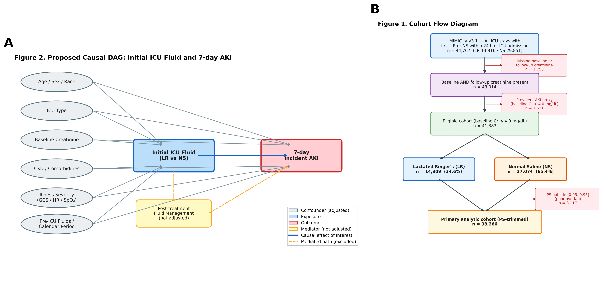
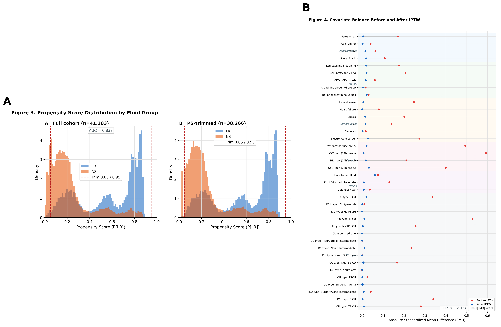
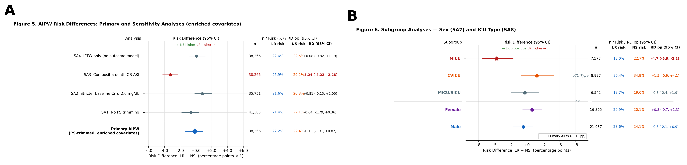
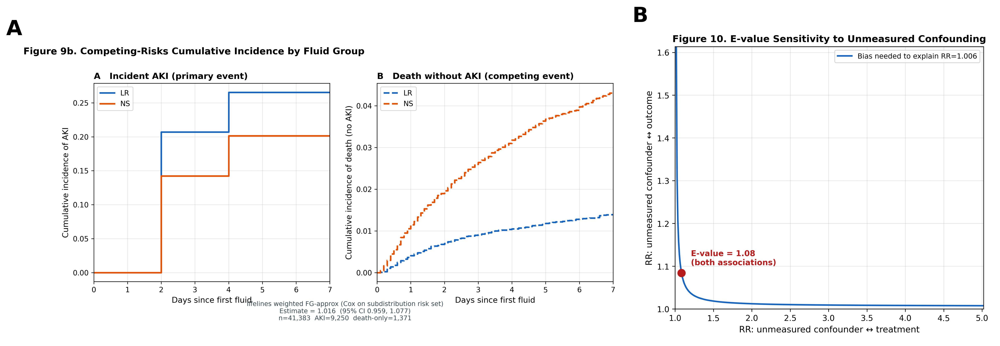
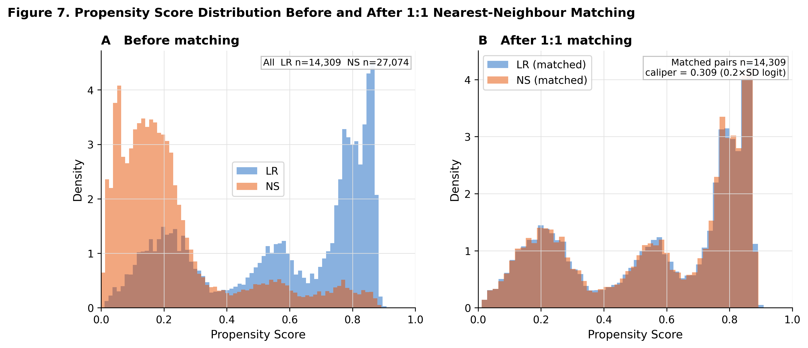
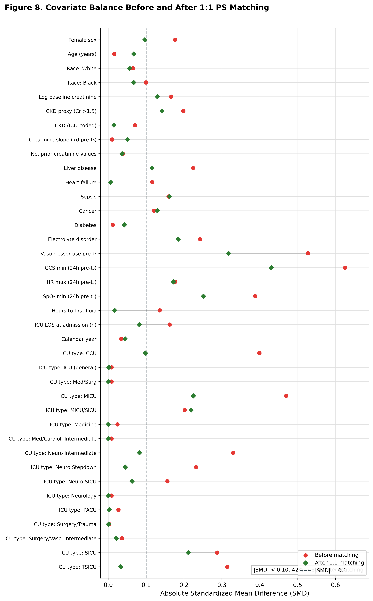
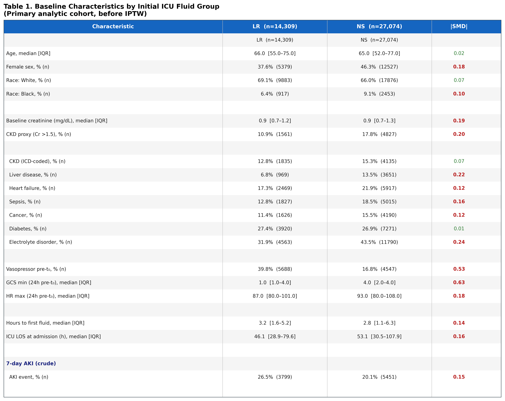

# Initial ICU Fluid Choice (Lactated Ringer's vs Normal Saline) and Seven-Day Incident Acute Kidney Injury in MIMIC-IV: A Target-Trial Emulation

**Final Report — GMS 7858, Causal Artificial Intelligence for Health Research, University of Florida**

**Team members:** Ahmed Soliman; Daling Shi

**Date:** November 2026

---

## Abstract

**Background.** Lactated Ringer's (LR) and 0.9% sodium chloride (normal saline, NS) are the two most common resuscitation crystalloids in the intensive care unit (ICU). Randomized trials of balanced-solution *policies* (SMART, PLUS) have reported conflicting kidney outcomes and do not isolate the effect of *selecting LR rather than NS as the first recorded ICU fluid* under subsequent usual care. We emulated a target trial of that specific decision in MIMIC-IV.

**Methods.** Among adults in their first ICU stay whose first qualifying standalone LR or NS administration began within 24 hours of ICU admission, time zero was the start of that administration, and assignment was by the initial fluid despite later switching. The outcome was in-hospital, creatinine-defined incident acute kidney injury (AKI) (KDIGO stage ≥1: a rise of ≥0.3 mg/dL within 48 hours or ≥1.5× the pretreatment reference within seven days), observed after time zero and before discharge or day seven. The estimand was the LR-minus-NS adjusted risk difference, estimated by augmented inverse-probability weighting (AIPW) with propensity-score (PS) trimming to [0.05, 0.95] and 200-replicate bootstrap 95% confidence intervals (CIs). A prespecified battery of sensitivity, subgroup, competing-risks, and unmeasured-confounding analyses accompanied the primary estimate.

**Results.** Of 44,767 extracted ICU stays, 41,383 met renal-eligibility criteria and 38,266 remained after PS trimming (primary cohort). The adjusted seven-day risk difference was **−0.13 percentage points (pp) (95% CI −1.31 to +0.87)** — a precise null. The estimate was stable without trimming (−0.64 pp), under stricter baseline rules, under IPTW only (+0.09 pp), under 1:1 PS matching (−0.53 pp), and under competing risks (cumulative-incidence difference +0.18 pp; Fine-Gray subdistribution hazard ratio [sHR] 1.02, 95% CI 0.96–1.08). Two signals departed from the null: a death-or-AKI composite favored LR (−3.24 pp), driven by mortality; and the effect was modified by ICU type, with LR protective in the medical ICU (−4.69 pp, CI −6.87 to −2.16) but not the cardiovascular ICU. A 48-hour-window analysis showed a small harm signal for LR (+1.08 pp). The primary E-value was 1.08 (CI bound 1.00).

**Conclusions.** Selecting LR rather than NS as the first recorded ICU fluid was not associated with a difference in seven-day creatinine-defined incident AKI overall. The null was robust across exposure, baseline, overlap, and competing-event specifications and insensitive to unmeasured confounding. Heterogeneity by ICU type and a timing-dependent 48-hour signal are hypothesis-generating.

---

## 1. Introduction

Intravenous crystalloids are among the most frequently administered treatments in critical care, and the choice between balanced solutions such as LR and 0.9% saline has been debated for a decade. The SMART trial reported fewer major adverse kidney events at 30 days with balanced crystalloids than with saline in critically ill adults, whereas the larger PLUS trial found no evidence that Plasma-Lyte 148 lowered death or AKI relative to saline.[^1][^2] These trials compare *treatment policies and products* over an entire ICU course; neither estimates the narrower, more actionable decision a clinician faces at the bedside: which fluid to give *first*, under subsequent usual care.

That decision is heavily confounded in routine data. ICU type, underlying illness, kidney function, hemodynamic state, and pre-ICU fluids can all influence both the initial fluid chosen and the subsequent risk of AKI. An explicit target-trial specification helps prevent post-treatment information from leaking into baseline covariates and aligns follow-up with the moment of the decision.[^3] We therefore emulated a target trial of initial LR versus initial NS in MIMIC-IV,[^4] estimating an absolute risk difference in seven-day, in-hospital, creatinine-defined incident AKI, reported alongside a prespecified battery of sensitivity, subgroup, competing-risks, and unmeasured-confounding analyses. The contributions of this report are: (i) a decision-level estimand with an explicit target-trial protocol; (ii) a doubly robust absolute-risk estimate; (iii) a comprehensive robustness battery treated as a first-class result; (iv) competing-risks and E-value quantification; (v) characterization of clinically relevant heterogeneity by ICU type; and (vi) a reproducible, seed-fixed analysis pipeline.

## 2. Methods

**Data source.** MIMIC-IV v3.1 is a de-identified electronic health record dataset combining ICU treatment and hospital-wide laboratory records.[^4] Extraction used the raw source tables (`labevents`, `diagnoses_icd`, `inputevents`, `chartevents`, `patients`, `admissions`, `icustays`).

**Target trial, exposure, and time zero.** Eligible patients were adults (≥18 years) in their first ICU stay whose first qualifying standalone LR or NS administration began within 24 hours of ICU admission. **Time zero** was the recorded initiation of that administration. Assignment was by the initial fluid and did not change with later switching (an intention-to-treat analogue for the first-fluid decision). Standalone fluids were separated from drug carriers and flushes by item label and administration fields; completed infusion volume, known only after time zero, did not determine eligibility.

**Renal eligibility and outcome.** A pretreatment reference creatinine was defined from values before time zero. Patients with baseline creatinine >4.0 mg/dL were excluded as a conservative prevalent-AKI/advanced-CKD proxy (varied in sensitivity analyses). The outcome was **in-hospital, creatinine-defined incident AKI** (KDIGO stage ≥1): a serum creatinine rise of ≥0.3 mg/dL within 48 hours, or ≥1.5× the pretreatment reference within seven days, after time zero and before discharge or day seven.[^5] A missing follow-up creatinine was never counted as "no AKI"; urine-output criteria were not inferred.

**Confounders.** Guided by a prespecified causal diagram (Figure 1A), the adjustment set comprised pretreatment common causes of fluid choice and AKI: age, sex, recorded race; ICU type; baseline creatinine (log) and a CKD proxy; diagnosis-derived comorbidities available before time zero (CKD, liver disease, heart failure, sepsis, cancer, diabetes, electrolyte disorder); illness-severity and hemodynamic proxies from the 24 hours before time zero (minimum GCS, maximum heart rate, minimum SpO₂, minimum MAP); pre-treatment vasopressor use; the pre-treatment creatinine trajectory (slope and count of prior values); timing variables; and calendar period. Post-treatment quantities were excluded from baseline adjustment. Race was treated as a recorded social/administrative variable, not a biological proxy.

**Estimation.** The primary estimator was **AIPW**, a doubly robust estimator of the marginal LR-minus-NS risk difference combining a logistic PS model and a logistic outcome model.[^6] Propensity scores were trimmed to [0.05, 0.95] (Crump restriction), defining the primary target population. Covariate balance was assessed by standardized mean difference (SMD) before and after stabilized IPTW (target |SMD| < 0.1). 95% CIs were percentile bootstrap (200 replicates), refitting the PS model per replicate. Secondary/sensitivity analyses: 1:1 nearest-neighbor PS matching (caliper 0.2 × SD[logit PS]); no PS trimming (SA1); stricter baseline Cr ≤2.0 (SA2) and ≤3.0 (SA6a); death-or-AKI composite (SA3); IPTW only (SA4); 48-hour creatinine window (SA5); sex (SA7) and ICU-type (SA8) subgroups; competing-risks cumulative-incidence and a canonical Fine-Gray sHR with death without AKI as the competing event (SA10); and an E-value for unmeasured confounding.[^7] Analyses used Python (scikit-learn, lifelines, joblib); the random seed was fixed at 42.

## 3. Results

**Cohort.** Of 44,767 extracted ICU stays with LR or NS in the first 24 hours (14,916 LR; 29,851 NS), 41,383 had both baseline and follow-up creatinine with baseline Cr ≤4.0 mg/dL; after PS trimming, **38,266** formed the primary cohort (Figure 1B). The PS model AUC was ≈0.83; trimming removed poor-overlap tails (Figure 2A). After stabilized IPTW most covariates reached |SMD| < 0.1 (Figure 2B); baseline characteristics appear in Table 1.

**Primary estimand.** The adjusted seven-day LR-minus-NS risk difference was **−0.13 pp (95% CI −1.31 to +0.87)**, with standardized seven-day risks of 22.2% (LR) and 22.4% (NS) — a precise null excluding effects larger than ≈±1.3 pp.

**Sensitivity and secondary analyses (Table 2, Figure 3A).** The null was stable: no trimming −0.64 pp (−1.79, +0.36); Cr ≤2.0 +0.81 pp (−0.15, +2.00); IPTW only +0.09 pp (−0.82, +1.19); Cr ≤3.0 +0.00 pp (−1.08, +1.22); 1:1 PS matching −0.53 pp (−1.91, +0.75; 12,822 pairs; Figures 5–6). Two analyses departed from the null: the **death-or-AKI composite** favored LR (−3.24 pp [−4.22, −2.28]), reflecting the mortality component since AKI alone was null; and a **48-hour window** showed a small harm signal for LR (+1.08 pp [+0.33, +2.07]).

**Subgroups (Figure 3B).** Effect modification by ICU type was pronounced: in the **medical ICU**, LR was protective (−4.69 pp [−6.87, −2.16]); in the cardiovascular ICU the estimate was null and directionally opposite (+1.54 pp [−0.91, +4.14]); in the combined medical/surgical ICU it was null (−0.32 pp). Sex subgroups were null (female +0.80 pp; male −0.55 pp).

**Competing risks (Figure 4A).** Cumulative-incidence functions for AKI were nearly superimposed through day 7. The IPTW-adjusted day-7 cumulative-incidence difference was **+0.18 pp (−0.75, +1.20)**, and the Fine-Gray **sHR was 1.02 (95% CI 0.96–1.08)** — no difference in the subdistribution hazard of AKI.

**Unmeasured confounding (Figure 4B).** The primary risk ratio was 0.994, with an **E-value of 1.08** (point) and **1.00** (CI bound): because the interval already includes the null, essentially no unmeasured confounding is required to be compatible with no effect.

**Table 2. Results summary — all analyses with 200-replicate bootstrap 95% CIs** (LR-minus-NS risk differences in pp unless noted; Fine-Gray row is an sHR).

| Analysis | n | Estimate | 95% CI |
|---|---|---|---|
| Primary AIPW (PS-trimmed) | 38,266 | −0.13 pp | (−1.31, +0.87) |
| SA1: No PS trimming | 41,383 | −0.64 pp | (−1.79, +0.36) |
| SA2: Baseline Cr ≤2.0 | 35,751 | +0.81 pp | (−0.15, +2.00) |
| SA3: Composite death-or-AKI | 38,266 | −3.24 pp | (−4.22, −2.28) |
| SA4: IPTW-only | 38,266 | +0.09 pp | (−0.82, +1.19) |
| SA5: 48h creatinine window | 38,173 | +1.08 pp | (+0.33, +2.07) |
| SA6a: Baseline Cr ≤3.0 | 37,384 | +0.00 pp | (−1.08, +1.22) |
| SA7: Female | 16,365 | +0.80 pp | (−0.67, +2.31) |
| SA7: Male | 21,937 | −0.55 pp | (−2.10, +0.90) |
| SA8: CVICU | 8,927 | +1.54 pp | (−0.91, +4.14) |
| SA8: MICU | 7,577 | −4.69 pp | (−6.87, −2.16) |
| SA8: MICU/SICU | 6,542 | −0.32 pp | (−2.43, +1.86) |
| PS matching (1:1 NN) | 12,822 | −0.53 pp | (−1.91, +0.75) |
| SA10: Fine-Gray sHR | 41,383 | 1.02 (sHR) | (0.96, 1.08) |

## 4. Discussion

Selecting LR rather than NS as the *first recorded* ICU fluid was not associated with a difference in seven-day, in-hospital, creatinine-defined incident AKI. The estimate was a precise null and remained null across trimming, baseline-creatinine rules, estimator choice, PS matching, and a competing-risks framework, and was insensitive to unmeasured confounding by the E-value. This is a narrower, more actionable contrast than SMART and PLUS; our neutral finding is consistent with PLUS's null and does not reproduce SMART's balanced-crystalloid advantage for the specific decision and endpoint studied.[^1][^2]

Two findings are hypothesis-generating. The apparent advantage of LR on the death-or-AKI composite was driven by mortality, not AKI, and should not be read as a kidney benefit, though it motivates a mortality-focused analysis. The strong effect modification by ICU type — LR protective in the medical ICU but not the cardiovascular ICU — suggests any benefit of balanced fluids may concentrate in medical-ICU phenotypes (e.g., sepsis, metabolic acidosis) rather than post-cardiac-surgery populations. The small 48-hour harm signal, absent at seven days, most plausibly reflects early creatinine dynamics and dilution rather than a durable effect, but underscores that the ascertainment window materially affects a crystalloid comparison.

**Limitations.** The estimand is an observational analogue conditional on adequate measured-confounding control, positivity, and a well-defined first-fluid contrast; residual confounding by fluid dose and later care cannot be excluded. The analysis is single-center. Creatinine monitoring is unequal across patients, and the outcome is restricted to creatinine-defined, in-hospital AKI; urine-output AKI is not captured. Baseline exclusion used a creatinine-threshold proxy rather than fully time-stamped trajectories. The competing-risks analysis uses coarse AKI event timing, so the cumulative-incidence *shape* is more reliable than its exact timing.

**Conclusion.** For the bedside-actionable decision of which crystalloid to give first in the ICU, LR and NS yielded indistinguishable seven-day creatinine-defined AKI risk overall, robust across a comprehensive sensitivity battery. Heterogeneity by ICU type and sensitivity to the ascertainment window are the most promising directions for prospective study.

## Author Contributions

Reported following the CRediT taxonomy. **Ahmed Soliman:** Conceptualization; Methodology (target-trial specification, estimand, confounder/DAG design); Software (extraction-to-figure pipeline, AIPW/IPTW, PS matching, competing-risks and E-value analyses); Formal analysis; Data curation; Visualization; Writing – original draft; Writing – review & editing. **Daling Shi:** Methodology (sensitivity-analysis and competing-risks design); Validation (independent review of estimation and results); Formal analysis (interpretation of subgroup and competing-risks findings); Writing – review & editing. Both authors approved the final report and take responsibility for its content. The authors declare no competing interests. MIMIC-IV v3.1 is available to credentialed users via PhysioNet; analysis code is archived with a fixed random seed (42) for reproducibility.

## Figures

Figures are organized into four composite panels; sub-figures are labeled **A** and **B**.

{ width=98% }

{ width=98% }

{ width=98% }

{ width=98% }

{ width=88% }

{ width=50% }

**Table 1. Baseline characteristics by initial ICU fluid group (primary cohort, before IPTW).**

{ width=88% }

---

## References

[^1]: Semler MW, Self WH, Wanderer JP, et al. Balanced crystalloids versus saline in critically ill adults. N Engl J Med. 2018;378(9):829-839.

[^2]: Finfer S, Micallef S, Hammond N, et al. Balanced multielectrolyte solution versus saline in critically ill adults. N Engl J Med. 2022;386(9):815-826.

[^3]: Hernán MA, Robins JM. Using big data to emulate a target trial when a randomized trial is not available. Am J Epidemiol. 2016;183(8):758-764.

[^4]: Johnson AEW, Bulgarelli L, Shen L, et al. MIMIC-IV, a freely accessible electronic health record dataset. Sci Data. 2023;10(1):1.

[^5]: Kidney Disease: Improving Global Outcomes (KDIGO) Acute Kidney Injury Work Group. KDIGO clinical practice guideline for acute kidney injury. Kidney Int Suppl. 2012;2(1):1-138.

[^6]: Bang H, Robins JM. Doubly robust estimation in missing data and causal inference models. Biometrics. 2005;61(4):962-973.

[^7]: VanderWeele TJ, Ding P. Sensitivity analysis in observational research: introducing the E-value. Ann Intern Med. 2017;167(4):268-274.
