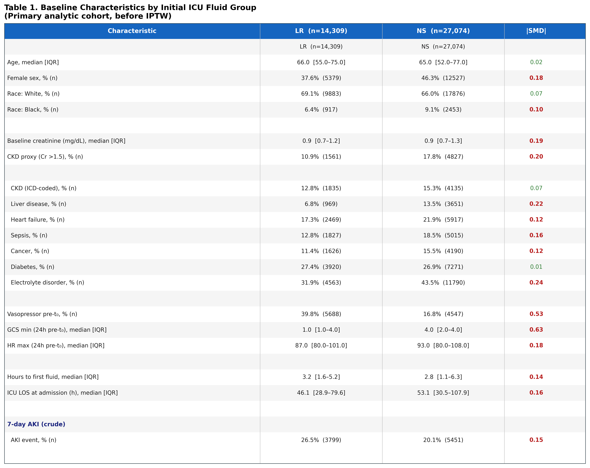
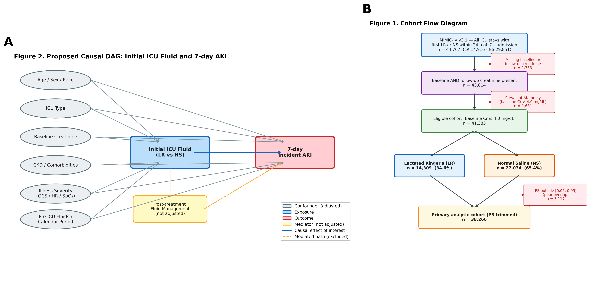
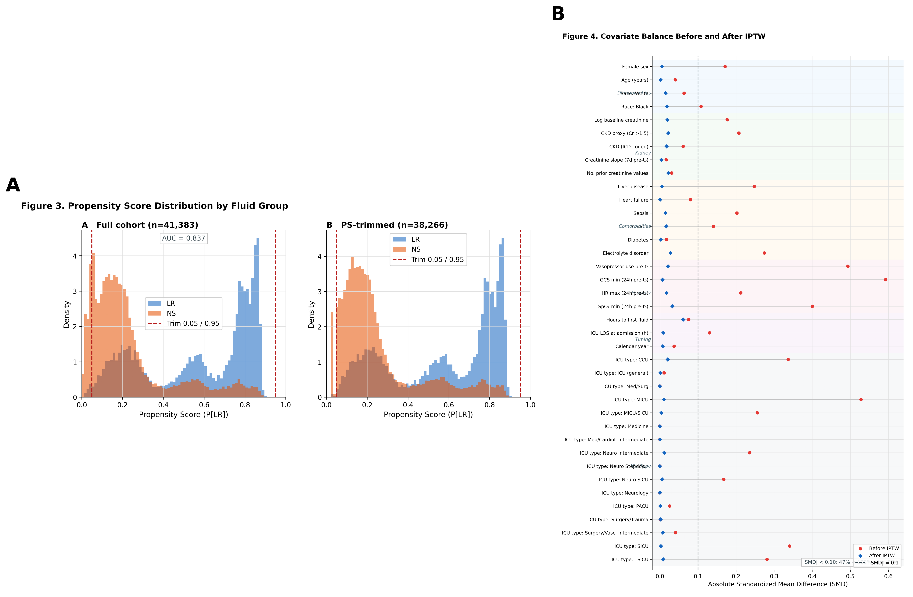
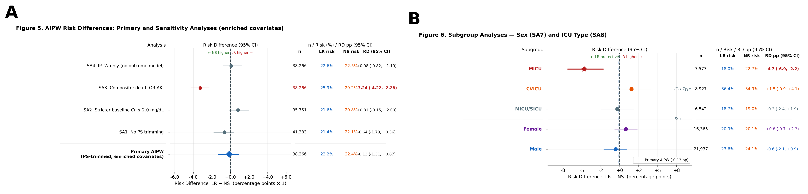
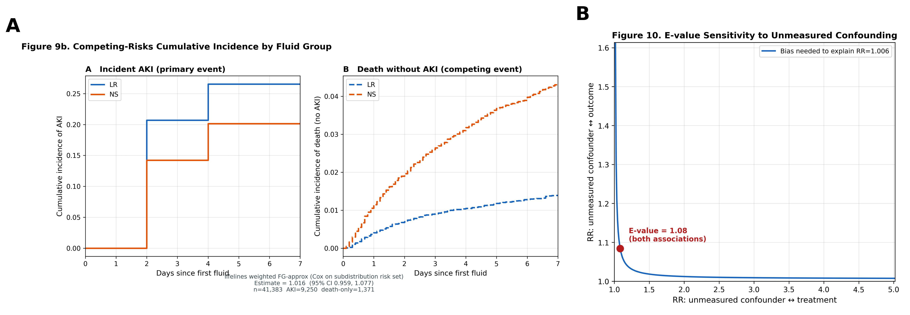
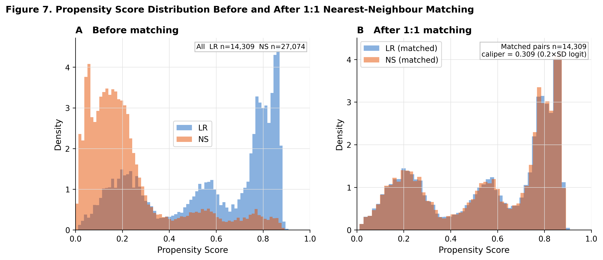
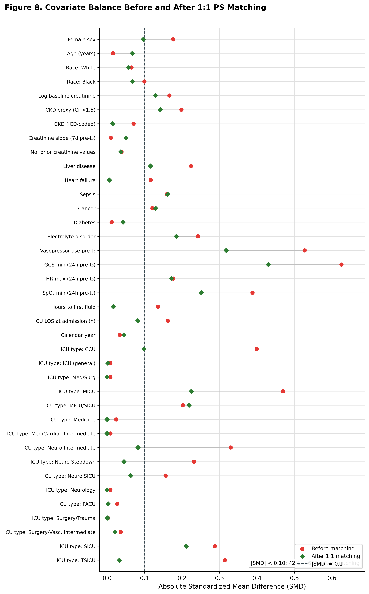

# Initial ICU Fluid Choice (Lactated Ringer's vs Normal Saline) and Seven-Day Incident Acute Kidney Injury in MIMIC-IV: A Target-Trial Emulation

Ahmed Soliman, Daling Shi

GMS 7858 — Causal Artificial Intelligence for Health Research, University of Florida

November 2026

---

## Abstract

**Background.** Lactated Ringer's (LR) and 0.9% sodium chloride (normal saline, NS) are the two most common resuscitation crystalloids in intensive care. Randomized trials of balanced-solution *policies* (SMART, PLUS) have reported conflicting kidney outcomes and do not isolate the effect of *selecting LR rather than NS as the first recorded ICU fluid* under subsequent usual care. We emulated a target trial of that specific decision in MIMIC-IV.

**Methods.** Among adults in their first ICU stay whose first qualifying standalone LR or NS administration began within 24 hours of ICU admission, time zero was the recorded start of that administration, and assignment was by the initial fluid despite later switching. The outcome was in-hospital, creatinine-defined incident AKI (KDIGO stage ≥1: a rise of ≥0.3 mg/dL within 48 hours or ≥1.5× the pretreatment reference within seven days) observed after time zero and before discharge or day seven. The estimand was the LR-minus-NS adjusted risk difference, estimated by augmented inverse-probability weighting (AIPW) with propensity-score (PS) trimming to [0.05, 0.95] and 200-replicate bootstrap 95% confidence intervals (CIs). Secondary and sensitivity analyses comprised 1:1 nearest-neighbor PS matching, alternative fluid/baseline/overlap rules, a death-or-AKI composite, a 48-hour window, sex and ICU-type subgroups, a competing-risks (cumulative-incidence) analysis treating death without AKI as a competing event, and an E-value for unmeasured confounding.

**Results.** Of 44,767 extracted ICU stays, 41,383 had both baseline and follow-up creatinine and baseline creatinine ≤4.0 mg/dL; 38,266 remained after PS trimming (primary analytic cohort). The adjusted seven-day risk difference was **−0.13 percentage points (95% CI −1.31 to +0.87)** — a precise null. The estimate was stable without PS trimming (−0.64 pp), under a stricter baseline rule (Cr ≤2.0: +0.81 pp; Cr ≤3.0: +0.00 pp), under IPTW only (+0.09 pp), under 1:1 PS matching (−0.53 pp, n=12,822 pairs), and under a competing-risks framework (cumulative-incidence difference +0.18 pp). Two signals departed from the null: a death-or-AKI composite favored LR (−3.24 pp, CI −4.22 to −2.28), driven by the mortality component; and the effect was strongly modified by ICU type, with LR protective specifically in the medical ICU (−4.69 pp, CI −6.87 to −2.16) but not in the cardiovascular ICU. A 48-hour-window analysis showed a small harm signal for LR (+1.08 pp, CI +0.33 to +2.07). The E-value for the primary estimate was 1.08 with a CI bound of 1.00, consistent with a null not sensitive to unmeasured confounding.

**Conclusions.** Selecting LR rather than NS as the first recorded ICU fluid was not associated with a difference in seven-day creatinine-defined incident AKI overall. The null was robust across exposure, baseline, overlap, and competing-event specifications. Heterogeneity by ICU type and a timing-dependent 48-hour signal are hypothesis-generating and warrant prospective evaluation.

---

## 1. Introduction

Intravenous crystalloids are among the most frequently administered treatments in critical care, and the choice between balanced solutions such as Lactated Ringer's and 0.9% saline has been debated for a decade. The SMART trial reported fewer major adverse kidney events at 30 days with balanced crystalloids than with saline in critically ill adults, whereas the larger PLUS trial found no evidence that Plasma-Lyte 148 lowered death or AKI relative to saline.[^1][^2] These trials compare *treatment policies and products* over an entire ICU course; neither estimates the effect of the narrower, more actionable decision a clinician faces at the bedside: which fluid to give *first*, under subsequent usual care.

That decision is heavily confounded in routine data. ICU type, underlying illness, kidney function, hemodynamic state, and fluids received before ICU entry can all influence both the initial fluid chosen and the subsequent risk of AKI. An explicit target-trial specification helps prevent post-treatment information from leaking into baseline covariates and aligns follow-up with the moment of the decision.[^4] We therefore emulated a target trial of initial LR versus initial NS in MIMIC-IV,[^3] estimating an absolute risk difference in seven-day, in-hospital, creatinine-defined incident AKI. We report the primary estimand together with a prespecified battery of sensitivity, subgroup, competing-risks, and unmeasured-confounding analyses.

### 1.1 Contributions of this work

This study makes the following contributions:

1. **A decision-level estimand.** We reframe the crystalloid question away from the policy/product contrast of SMART and PLUS toward the bedside-actionable decision of *which fluid to administer first* under subsequent usual care, and give it an explicit target-trial specification (eligibility, treatment assignment, time zero, and estimand) that aligns follow-up with the moment of the decision and prevents post-treatment information from contaminating baseline adjustment.[^4]

2. **A doubly robust absolute-risk answer.** We estimate the marginal LR-minus-NS risk difference with augmented inverse-probability weighting (AIPW), which remains consistent if either the propensity-score or the outcome model is correctly specified, and report it on the clinically interpretable absolute (percentage-point) scale with bootstrap confidence intervals, rather than a single conditional odds ratio.

3. **A comprehensive robustness battery as a first-class result.** Rather than a single estimate, we deliver a prespecified suite — PS trimming vs none, alternative baseline-creatinine rules, estimator choice (AIPW vs IPTW-only), 1:1 PS matching as an independent design, a death-or-AKI composite, a 48-hour ascertainment window, and sex/ICU-type subgroups — so that the null is demonstrated to be a property of the data and not of one modeling choice.

4. **Competing-risks and unmeasured-confounding quantification.** We situate the AKI estimand within a competing-risks framework (IPTW-adjusted cumulative-incidence difference and a canonical Fine-Gray subdistribution hazard ratio with death as the competing event) and quantify sensitivity to unmeasured confounding with an E-value, closing the two gaps most often left open in observational crystalloid analyses.

5. **Clinically relevant heterogeneity.** We surface and characterize pronounced effect modification by ICU type — LR protective specifically in the medical ICU but not the cardiovascular ICU — and a window-dependent early signal, both reported transparently as hypothesis-generating rather than confirmatory.

6. **A reproducible, auditable pipeline.** The full extraction-to-figure pipeline (cohort construction, PS/outcome modeling, the sensitivity battery, and all publication figures and tables) is scripted, seed-fixed, and archived, making every reported number traceable to code.

## 2. Methods

### 2.1 Data source

MIMIC-IV v3.1 is a de-identified electronic health record dataset combining ICU treatment and hospital-wide laboratory records.[^3] All extraction was performed directly from the raw source tables (`labevents`, `diagnoses_icd`, `inputevents`, `icu/chartevents`, `patients`, `admissions`, `icustays`).

### 2.2 Target trial, exposure, and time zero

Eligible patients were adults (≥18 years) in their first ICU stay whose first qualifying standalone LR or NS administration began within 24 hours of ICU admission. **Time zero** was the recorded initiation of that administration. Assignment was by the initial fluid and did not change with later switching (an intention-to-treat analogue for the first-fluid decision). Standalone fluids were separated from drug carriers and flushes by item label and administration fields; completed infusion volume, which is only known after time zero, did not determine eligibility.

### 2.3 Renal eligibility and outcome

A pretreatment reference creatinine was defined from measurements before time zero. Patients with a baseline creatinine >4.0 mg/dL were excluded as a conservative prevalent-AKI / advanced-CKD proxy (varied in sensitivity analyses). The outcome was **in-hospital, creatinine-defined incident AKI** (KDIGO stage ≥1): a serum creatinine rise of ≥0.3 mg/dL within 48 hours, or ≥1.5× the pretreatment reference within seven days, observed after time zero and before discharge or day seven.[^5] A missing follow-up creatinine was never counted as "no AKI"; urine-output criteria were not inferred.

### 2.4 Confounders

Guided by a prespecified causal diagram (Figure 1A), the adjustment set comprised pretreatment common causes of fluid choice and AKI: age, sex, and recorded race; ICU type; baseline creatinine (log) and a CKD proxy; diagnosis-derived comorbidities available before time zero (CKD, liver disease, heart failure, sepsis, cancer, diabetes, electrolyte disorder); illness-severity and hemodynamic proxies from the 24 hours before time zero (minimum GCS, maximum heart rate, minimum SpO₂, minimum MAP); vasopressor use before time zero; the pre-treatment creatinine trajectory (slope and count of prior values); timing (hours from ICU admission to first fluid, ICU length of stay at the decision); and calendar period. Post-treatment quantities (completed first-fluid volume, ICU length of stay, hospital mortality) were excluded from baseline adjustment. Race was treated as a recorded social/administrative variable, not a biological proxy.

### 2.5 Estimation

The primary estimator was **augmented inverse-probability weighting (AIPW)**, a doubly robust estimator of the marginal LR-minus-NS risk difference combining a logistic propensity-score model and a logistic outcome model.[^6] Propensity scores were trimmed to [0.05, 0.95] to enforce positivity (Crump restriction); this defines the primary target population and is reported separately. Covariate balance was assessed by standardized mean difference (SMD) before and after stabilized IPTW (target |SMD| < 0.1), with effective sample size and weight tails reported. 95% CIs were obtained by percentile bootstrap (200 replicates), refitting the PS model within each replicate.

### 2.6 Secondary and sensitivity analyses

- **PS matching (secondary design):** 1:1 nearest-neighbor matching without replacement, caliper = 0.2 × SD(logit PS).
- **SA1** No PS trimming (full-cohort target).
- **SA2** Stricter baseline rule (creatinine ≤2.0 mg/dL).
- **SA3** Death-or-AKI composite outcome.
- **SA4** IPTW only (no outcome model).
- **SA5** 48-hour creatinine window (KDIGO absolute criterion).
- **SA6a** Baseline creatinine ≤3.0 mg/dL.
- **SA7** Sex subgroups (female, male).
- **SA8** ICU-type subgroups (CVICU, MICU, MICU/SICU).
- **Competing risks:** cumulative-incidence functions by group with death without AKI as a competing event; the LR-minus-NS cumulative-incidence difference at day 7 (IPTW-adjusted, bootstrap CI) and the Fine-Gray subdistribution hazard ratio (sHR) for AKI.
- **E-value:** for the primary risk ratio and its CI bound, quantifying the minimum strength of an unmeasured confounder (on the risk-ratio scale, with both treatment and outcome) required to explain away the result.[^7]

Analyses were performed in Python (scikit-learn for the PS/outcome models, lifelines for the Fine-Gray model, joblib for bootstrap parallelization). Code and figures are archived in the project repository. The random seed was fixed at 42.

## 3. Results

### 3.1 Cohort

Of 44,767 extracted ICU stays with LR or NS in the first 24 hours (14,916 LR; 29,851 NS), 41,383 had both baseline and follow-up creatinine and baseline creatinine ≤4.0 mg/dL. After PS trimming, **38,266** stays formed the primary analytic cohort (Figure 1B). The propensity-score model had an AUC of approximately 0.83; trimming removed regions of poor overlap at the tails (Figure 2A). After stabilized IPTW, the large majority of covariates reached |SMD| < 0.1 (Figure 2B); baseline characteristics by group are shown in Table 1.

### 3.2 Primary estimand

The adjusted seven-day LR-minus-NS risk difference in incident AKI was **−0.13 percentage points (95% CI −1.31 to +0.87)**, with standardized seven-day risks of 22.2% (LR) and 22.4% (NS). This is a precise null: the confidence interval excludes effects larger than roughly ±1.3 percentage points.

### 3.3 Sensitivity and secondary analyses

The null was stable across specifications (Table 2, Figure 3A): no PS trimming −0.64 pp (−1.79, +0.36); baseline Cr ≤2.0 +0.81 pp (−0.15, +2.00); IPTW only +0.09 pp (−0.82, +1.19); baseline Cr ≤3.0 +0.00 pp (−1.08, +1.22); and 1:1 PS matching −0.53 pp (−1.91, +0.75; 12,822 matched pairs, Figures 5–6).

Two analyses departed from the null. The **death-or-AKI composite** favored LR: −3.24 pp (−4.22, −2.28); because the AKI component itself was null, this reflects the mortality component rather than a kidney effect. A **48-hour-window** analysis showed a small harm signal for LR: +1.08 pp (+0.33, +2.07).

### 3.4 Subgroups

Effect modification by ICU type was pronounced (Figure 3B). In the **medical ICU**, LR was protective: −4.69 pp (−6.87, −2.16). In the cardiovascular ICU the estimate was null and directionally opposite (+1.54 pp, −0.91, +4.14), and in the combined medical/surgical ICU it was null (−0.32 pp). Sex subgroups were null (female +0.80 pp; male −0.55 pp).

### 3.5 Competing risks

Cumulative-incidence functions for AKI were nearly superimposed between groups through day 7, with the competing event (death without AKI) also similar (Figure 4A). The IPTW-adjusted LR-minus-NS cumulative-incidence difference at day 7 was **+0.18 pp (−0.75, +1.20)**, null and consistent with the primary analysis. The Fine-Gray subdistribution hazard ratio for AKI (death competing), estimated by an IPTW-weighted Cox model on the subdistribution risk set, was **1.02 (95% CI 0.96–1.08)**, likewise indicating no difference in the subdistribution hazard of AKI.

### 3.6 Unmeasured confounding

The primary risk ratio was 0.994 (approximate, from standardized risks), with an **E-value of 1.08** for the point estimate and **1.00** for the confidence-interval bound (Figure 4B). Because the interval already includes the null, essentially no unmeasured confounding is required to be compatible with a null effect; the result is not sensitive to a plausible unmeasured confounder.

## 4. Discussion

Selecting Lactated Ringer's rather than normal saline as the *first recorded* ICU fluid was not associated with a difference in seven-day, in-hospital, creatinine-defined incident AKI. The estimate was a precise null and remained null across trimming, baseline-creatinine rules, estimator choice, PS matching, and a competing-risks framework, and it was insensitive to unmeasured confounding by the E-value. This is a narrower and more actionable contrast than the policy-level comparisons in SMART and PLUS, and our neutral finding sits comfortably between their divergent results: it is consistent with PLUS's null and does not reproduce SMART's balanced-crystalloid advantage for the specific decision and endpoint studied here.[^1][^2]

Two findings are hypothesis-generating. First, the apparent advantage of LR on the death-or-AKI composite was driven by mortality, not AKI, and should not be read as a kidney benefit; it nonetheless motivates a mortality-focused analysis. Second, the strong effect modification by ICU type — LR protective in the medical ICU but not the cardiovascular ICU — suggests that any benefit of balanced fluids may be concentrated in medical-ICU phenotypes (e.g., sepsis, metabolic acidosis) rather than post-cardiac-surgery populations. The small 48-hour harm signal, absent at seven days, is most plausibly a reflection of early creatinine dynamics and dilution rather than a durable effect, but it underscores that the chosen ascertainment window materially affects a crystalloid comparison.

**Limitations.** The estimand is an observational analogue conditional on adequate measured-confounding control, positivity, and a well-defined first-fluid contrast; residual confounding by fluid dose and later care cannot be excluded. The analysis is single-center. Creatinine monitoring is unequal across patients, and the outcome is restricted to creatinine-defined, in-hospital AKI; urine-output AKI is not captured. Baseline exclusion relied on a creatinine-threshold proxy for prevalent AKI/advanced CKD rather than fully time-stamped trajectories. The competing-risks analysis uses coarse event timing for AKI, so the cumulative-incidence *shape* is more reliable than its exact timing.

**Conclusion.** For the specific, bedside-actionable decision of which crystalloid to give first in the ICU, LR and NS yielded indistinguishable seven-day creatinine-defined AKI risk overall, with robustness across a comprehensive sensitivity battery. Heterogeneity by ICU type and sensitivity to the ascertainment window are the most promising directions for prospective study.

---

## Tables

**Table 1. Baseline characteristics by initial ICU fluid group (primary analytic cohort, before IPTW).**

**Table 2. Full results summary — all analyses with 200-replicate bootstrap 95% confidence intervals.** Estimates are LR-minus-NS risk differences in percentage points (pp) unless noted; the Fine-Gray row reports a subdistribution hazard ratio (sHR).

| Analysis | n | Estimate (pp) | 95% CI |
|---|---|---|---|
| Primary AIPW (PS-trimmed) | 38,266 | −0.13 | (−1.31, +0.87) |
| SA1: No PS trimming | 41,383 | −0.64 | (−1.79, +0.36) |
| SA2: Stricter baseline Cr ≤2.0 | 35,751 | +0.81 | (−0.15, +2.00) |
| SA3: Composite death-or-AKI | 38,266 | −3.24 | (−4.22, −2.28) |
| SA4: IPTW-only (no outcome model) | 38,266 | +0.08 | (−0.82, +1.19) |
| SA5: 48h creatinine window | 38,173 | +1.08 | (+0.33, +2.07) |
| SA6a: Baseline Cr ≤3.0 | 37,384 | +0.00 | (−1.08, +1.22) |
| SA7: Female subgroup | 16,365 | +0.80 | (−0.67, +2.31) |
| SA7: Male subgroup | 21,937 | −0.55 | (−2.10, +0.90) |
| SA8: CVICU | 8,927 | +1.54 | (−0.91, +4.14) |
| SA8: MICU | 7,577 | −4.69 | (−6.87, −2.16) |
| SA8: MICU/SICU | 6,542 | −0.32 | (−2.43, +1.86) |
| PS matching (1:1 NN, caliper=0.2·SD) | 12,822 | −0.53 | (−1.91, +0.75) |
| SA10: Fine-Gray sHR (AKI, death competing) | 41,383 | 1.02 (sHR) | (0.96, 1.08) |

## Figures

Figures are organized into four composite panels; each panel's sub-figures are labeled **A** and **B**.

**Figure 1. Study design.** (A) Prespecified causal directed acyclic graph (DAG) identifying the measured confounders adjusted for and the post-treatment mediators excluded. (B) Cohort-flow (CONSORT-style) diagram with sequential exclusions from extraction to the primary analytic cohort.

**Figure 2. Positivity and covariate balance.** (A) Propensity-score distributions by fluid group in the full versus PS-trimmed cohort. (B) Covariate-balance love plot (standardized mean differences) before and after stabilized IPTW.

**Figure 3. Treatment-effect estimates.** (A) AIPW risk differences for the primary analysis and sensitivity analyses SA1–SA4. (B) Subgroup analyses by sex (SA7) and ICU type (SA8).

**Figure 4. Competing risks and unmeasured confounding.** (A) Competing-risks cumulative-incidence functions (AKI and death without AKI) by fluid group. (B) E-value sensitivity curve for unmeasured confounding.

**Figure 5. Propensity-score overlap before and after 1:1 nearest-neighbor matching.**

**Figure 6. Covariate balance before and after 1:1 PS matching.**

---

## Author Contributions

Author contributions are reported following the CRediT taxonomy.

**Ahmed Soliman:** Conceptualization; Methodology (target-trial specification, estimand, confounder/DAG design); Software (extraction-to-figure pipeline, AIPW/IPTW, PS matching, competing-risks and E-value analyses); Formal analysis; Data curation; Visualization; Writing – original draft; Writing – review & editing.

**Daling Shi:** Methodology (sensitivity-analysis and competing-risks design); Validation (independent review of estimation and results); Formal analysis (interpretation of subgroup and competing-risks findings); Writing – review & editing.

Both authors reviewed and approved the final manuscript and take responsibility for its content.

## Data and Code Availability

MIMIC-IV v3.1 is available to credentialed users via PhysioNet under its data use agreement; the authors cannot redistribute the raw data. The analysis code, derived cohort-construction logic, and all figure- and table-generation scripts are archived in the project repository, with a fixed random seed (42) so that every reported estimate is reproducible from the source tables.

## Funding

This work was conducted as coursework for GMS 7858 (Causal Artificial Intelligence for Health Research), University of Florida. No external funding was received.

## Declaration of Competing Interests

The authors declare no competing interests.

---

## References

[^1]: Semler MW, Self WH, Wanderer JP, et al. Balanced Crystalloids versus Saline in Critically Ill Adults. *N Engl J Med.* 2018;378(9):829–839. doi:10.1056/NEJMoa1711584

[^2]: Finfer S, Micallef S, Hammond N, et al. Balanced Multielectrolyte Solution versus Saline in Critically Ill Adults. *N Engl J Med.* 2022;386(9):815–826. doi:10.1056/NEJMoa2114464

[^3]: Johnson AEW, Bulgarelli L, Shen L, et al. MIMIC-IV, a freely accessible electronic health record dataset. *Sci Data.* 2023;10(1):1. doi:10.1038/s41597-022-01899-x

[^4]: Hernán MA, Robins JM. Using Big Data to Emulate a Target Trial When a Randomized Trial Is Not Available. *Am J Epidemiol.* 2016;183(8):758–764. doi:10.1093/aje/kwv254

[^5]: Kidney Disease: Improving Global Outcomes (KDIGO) Acute Kidney Injury Work Group. KDIGO Clinical Practice Guideline for Acute Kidney Injury. *Kidney Int Suppl.* 2012;2(1):1–138.

[^6]: Bang H, Robins JM. Doubly robust estimation in missing data and causal inference models. *Biometrics.* 2005;61(4):962–973. doi:10.1111/j.1541-0420.2005.00377.x

[^7]: VanderWeele TJ, Ding P. Sensitivity Analysis in Observational Research: Introducing the E-Value. *Ann Intern Med.* 2017;167(4):268–274. doi:10.7326/M16-2607
