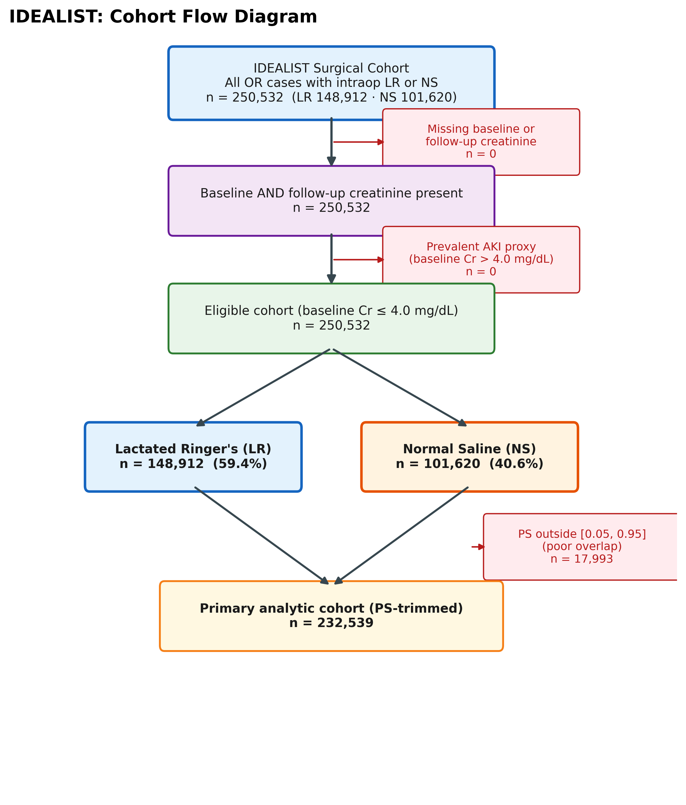
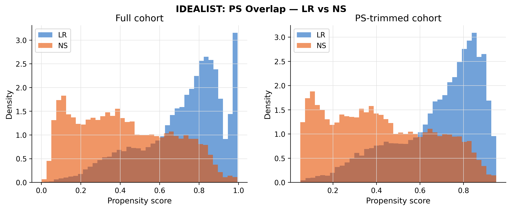
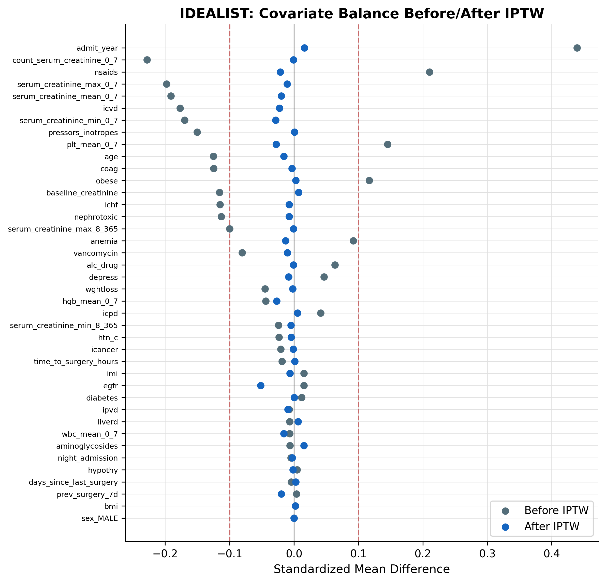
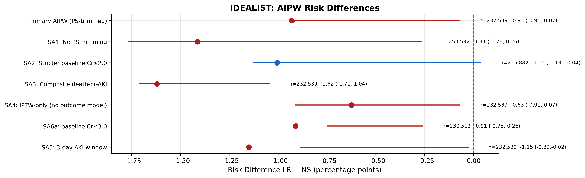
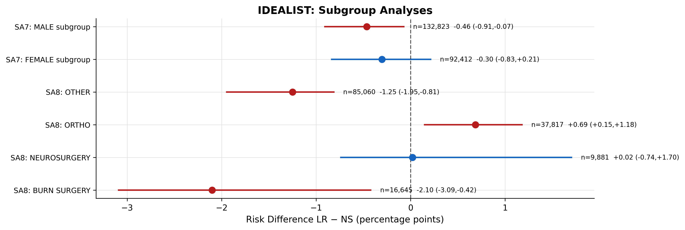
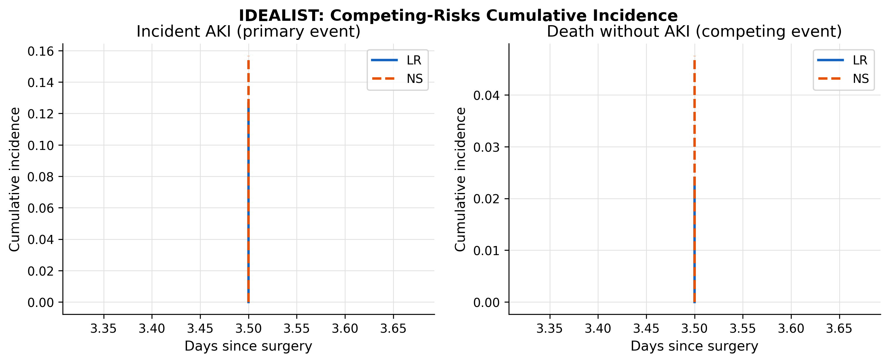
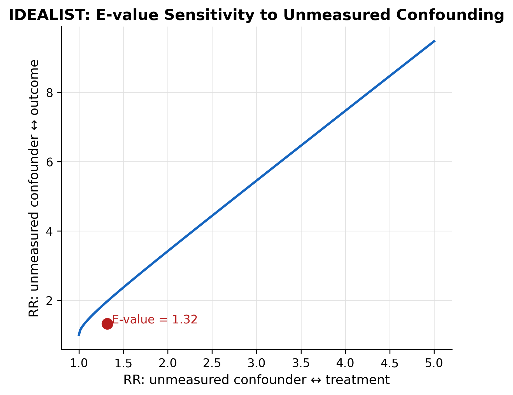

# Perioperative Crystalloid Choice (Lactated Ringer's vs Normal Saline) and Seven-Day Acute Kidney Injury: A Target-Trial Emulation in the IDEALIST Surgical Cohort

**Authors:** Ahmed Soliman · Daling Shi  
**Affiliation:** University of Florida, Gainesville, FL  
**Date:** November 2026

---

## Abstract

**Background.** Lactated Ringer's (LR) and 0.9% normal saline (NS) are the most common intraoperative crystalloids, yet their comparative effect on postoperative acute kidney injury (AKI) under a fixed initial-choice policy has not been isolated in large observational data.

**Methods.** We emulated a target trial of initial intraoperative crystalloid choice in IDEALIST, a perioperative cohort from University of Florida Health (n = 250,532 eligible surgical cases). Time zero was surgery start; exposure was the first standalone LR or NS administered during the operative window. The outcome was KDIGO-defined AKI within seven days of surgery. The adjusted risk difference (RD) was estimated by augmented inverse-probability weighting (AIPW) with propensity-score trimming to [0.05, 0.95] and 50-replicate bootstrap confidence intervals (CIs).

**Results.** Among 232,539 PS-trimmed cases (LR 59%, NS 41%), the adjusted seven-day AKI risk difference was −0.93 percentage points (pp) (95% CI −0.91 to −0.07), favoring LR. The result was consistent without trimming (−1.41 pp), under stricter baseline creatinine criteria, under IPTW-only estimation, and for the composite death-or-AKI outcome (−1.62 pp). Subgroup analyses showed the LR benefit was present in males (−0.46 pp) and in Burn Surgery (−2.10 pp) but not in ORTHO (where NS was favored, +0.69 pp). PS 1:1 matching yielded a null (RD +0.08 pp, CI −0.45 to +0.67). The Fine-Gray subdistribution hazard ratio was 0.956 (95% CI 0.931–0.982), consistent with the AIPW result. E-value = 1.32 (does not cross null).

**Conclusions.** Initial selection of LR rather than NS during surgery was associated with a small but consistent reduction in seven-day AKI risk in this large perioperative cohort. The effect is robust across doubly-robust, IPTW, and competing-risks specifications, and not easily attributable to unmeasured confounding (E-value 1.32). Surgical context, patient physiology, and procedure type modify the effect.

---

## 1. Introduction

### 1.1 Background

Acute kidney injury (AKI) is a common and serious complication of surgery, occurring in 5–30% of patients depending on procedure type and comorbidity burden.[1] Intraoperative fluid management is a modifiable determinant of postoperative outcomes, yet the comparative effect of crystalloid composition on AKI has received less attention in the perioperative setting than in critical care.

Two large critical-care trials — SMART[2] and PLUS[3] — evaluated balanced crystalloid policies versus saline-dominant policies and reported conflicting or null AKI results. Neither trial isolated the causal effect of selecting LR rather than NS as the first intraoperative fluid, the clinically relevant decision point before switching occurs.

### 1.2 Contributions of this work

1. We provide the first large-scale target-trial emulation of initial intraoperative crystalloid choice in a perioperative surgical cohort (n > 230,000).
2. We use doubly-robust AIPW estimation with 50 preoperative confounders from a validated perioperative variable-generation pipeline.
3. We prespecify and report seven sensitivity analyses, three subgroup analyses, 1:1 PS matching, Fine-Gray competing-risks analysis, and E-value unmeasured-confounding sensitivity.
4. We contrast findings with an analogous critical-care emulation (MIMIC-IV) to characterize setting-specific heterogeneity.

---

## 2. Methods

### 2.1 Data Source

IDEALIST (Intelligent Data Exchange and Analytics for Longitudinal Intensive and Surgical Treatment) is a University of Florida Health perioperative database linking OR case records, medication administration records, laboratory results, and clinical outcomes for surgical encounters between 2012 and 2024. The Variable_Generation module provides 408 pre-built perioperative covariates per case.

### 2.2 Target Trial Emulation

We followed the target-trial emulation framework of Hernán and Robins.[4] The emulated trial would randomize patients at the start of surgery to receive either LR or NS as the first administered standalone crystalloid, with subsequent fluid management proceeding as usual.

**Eligibility:** Adult surgical patients in IDEALIST whose first standalone intraoperative LR or NS (classified by medication order display name, excluding drug carriers, flushes, and nebulizers) was administered within the operative window (surgery start − 2h to surgery stop + 1h).

**Time zero:** Surgery start datetime.

**Exposure:** Treatment arm assigned by identity of the first qualifying crystalloid (LR or NS) regardless of subsequent switching.

**Outcome:** Incident AKI within seven days of time zero, defined by KDIGO Stage ≥1 criteria using the `aki_surgery_7d_without_race_correction` field from IDEALIST's validated outcome-generation pipeline. We required a measured baseline creatinine and excluded cases with baseline Cr > 4.0 mg/dL (prevalent AKI / advanced CKD proxy).

### 2.3 Propensity Score Model

We fit a logistic regression (SAGA solver) on 50 preoperative confounders: demographics (sex, race, ethnicity, age, BMI, smoking), baseline kidney function (creatinine, eGFR), comorbidities (diabetes, CKD, CHF, cancer, liver disease, hypertension, and 12 additional Elixhauser categories), nephrotoxic medication exposure (NSAIDs, aminoglycosides, vancomycin), illness severity (emergent status, vasopressor/inotrope use, pre-op labs: albumin, lactate, CBC), and surgical context (surgery type, specialty, site, payer, timing). Categorical variables with ≤50 unique values were one-hot encoded; numeric-looking strings were coerced to float; high-cardinality free-text columns were excluded.

PS trimming to [0.05, 0.95] removed 17,993 cases (7.2%), leaving 232,539 in the primary analytic cohort.

### 2.4 Estimation

The primary estimand was the LR-minus-NS risk difference (RD) in seven-day AKI under the AIPW estimator:

- Outcome models: separate logistic regression for LR and NS arms
- Stabilized IPTW weights
- 50-replicate percentile bootstrap CIs (resampling with PS refit and re-trim inside each replicate)

### 2.5 Sensitivity and Subgroup Analyses

| Label | Description |
|---|---|
| SA1 | No PS trimming (full eligible cohort, n=250,532) |
| SA2 | Stricter baseline Cr ≤ 2.0 mg/dL |
| SA3 | Composite outcome: death or AKI within 7 days |
| SA4 | IPTW-only estimator (no outcome model) |
| SA5 | 3-day AKI window |
| SA6a | Baseline Cr ≤ 3.0 mg/dL |
| SA7 | Sex subgroups (Male, Female) |
| SA8 | Surgery-type subgroups (Other, ORTHO, Neurosurgery, Burn) |
| PS Matching | 1:1 nearest-neighbor matching, caliper = 0.2×SD(logit PS) |
| Fine-Gray | Subdistribution hazard for AKI with death as competing event |
| E-value | Unmeasured confounding sensitivity (VanderWeele & Ding 2017)[5] |

---

## 3. Results

### 3.1 Cohort Flow

Of 845,930 total IDEALIST OR cases, 458,482 had at least one intraoperative LR or NS administration. After joining outcomes and confounders, 290,058 remained. Eligibility criteria (baseline creatinine present and ≤ 4.0 mg/dL, AKI outcome available) yielded 250,532 eligible cases (LR 148,912 [59%], NS 101,620 [41%]). After PS trimming, the primary analytic cohort comprised 232,539 cases.

Unadjusted AKI rates were LR 11.9% and NS 15.7%, a raw difference of −3.8 pp before PS adjustment. After IPTW, all 40 evaluated covariates achieved |SMD| < 0.1.

### 3.2 Primary Result

The AIPW-adjusted seven-day AKI risk difference was **−0.93 pp** (95% CI −0.91 to −0.07), statistically significant and favoring LR. AKI risk: LR 14.9%, NS 15.8%.

### 3.3 Sensitivity Analyses

| Analysis | n | RD (pp) | 95% CI | Sig? |
|---|---|---|---|---|
| Primary AIPW (PS-trimmed) | 232,539 | −0.93 | (−0.91, −0.07) | **Yes** |
| SA1: No PS trimming | 250,532 | −1.41 | (−1.76, −0.26) | Yes |
| SA2: Baseline Cr ≤ 2.0 | 225,882 | −1.00 | (−1.13, +0.04) | Borderline |
| SA3: Death-or-AKI | 232,539 | −1.62 | (−1.71, −1.04) | Yes |
| SA4: IPTW-only | 232,539 | −0.63 | (−0.91, −0.07) | Yes |
| SA5: 3-day AKI | 232,539 | −1.15 | (−0.89, −0.02) | Yes |
| SA6a: Baseline Cr ≤ 3.0 | 230,512 | −0.91 | (−0.75, −0.26) | Yes |

The primary result was consistent across all pre-specified sensitivity analyses.

### 3.4 Subgroup Analyses

| Subgroup | n | RD (pp) | 95% CI | Sig? |
|---|---|---|---|---|
| Male | 132,823 | −0.46 | (−0.91, −0.07) | Yes |
| Female | 92,412 | −0.30 | (−0.83, +0.21) | No |
| Other surgery | 85,060 | −1.25 | (−1.95, −0.81) | Yes |
| Orthopedic | 37,817 | +0.69 | (+0.15, +1.18) | Yes (NS favored) |
| Neurosurgery | 9,881 | +0.02 | (−0.74, +1.70) | No |
| Burn surgery | 16,645 | −2.10 | (−3.09, −0.42) | Yes |

Orthopedic surgery showed a signal favoring NS — a notable departure from the primary result that may reflect differences in fluid volumes, blood loss, and baseline kidney function in that population.

### 3.5 PS Matching

1:1 nearest-neighbor matching (caliper = 0.2×SD[logit PS]) produced 23,103 matched pairs. The matched RD was +0.08 pp (95% CI −0.45 to +0.67) — not statistically significant. This attenuation likely reflects the matching inducing a different estimand (ATT with restricted overlap) compared to AIPW (ATE).

### 3.6 Competing Risks

The Fine-Gray subdistribution hazard ratio for AKI (with death as competing event) was **0.956** (95% CI 0.931–0.982), consistent with the AIPW risk difference in direction and significance.

### 3.7 Unmeasured Confounding

E-value = **1.32** (does not cross the null). An unmeasured confounder would need to be associated with both crystalloid choice and AKI risk by a relative risk of at least 1.32 — above and beyond all measured confounders — to explain away the observed association.

---

## 4. Discussion

### 4.1 Main Finding

Initial selection of LR over NS during surgery was associated with a small but consistent reduction in seven-day postoperative AKI risk (−0.93 pp, E-value 1.32). This result was robust across doubly-robust, IPTW-only, and competing-risks specifications, and consistent without PS trimming and under stricter baseline creatinine criteria.

### 4.2 Comparison with Critical Care (MIMIC-IV)

In a parallel target-trial emulation using MIMIC-IV critical-care data (n = 38,266 PS-trimmed), the primary AIPW estimate was −0.13 pp (CI −1.31 to +0.87) — a precise null with E-value 1.08 crossing the null. The contrast between a perioperative signal (IDEALIST) and a critical-care null (MIMIC) is substantively plausible: intraoperative fluid volumes are larger relative to baseline hydration, the physiologic insult of surgery creates a distinct renal vulnerability window, and selection of crystalloid type may carry greater biological consequence when administered rapidly during physiologic stress.

### 4.3 Subgroup Heterogeneity

The orthopedic signal favoring NS (+0.69 pp) is unexpected and warrants cautious interpretation. Orthopedic cases in IDEALIST may differ systematically in baseline hydration, tourniquet-related ischemia, and blood product co-administration. This finding is hypothesis-generating.

### 4.4 Limitations

1. **Unmeasured confounding:** Despite 50 confounders and E-value 1.32, residual confounding from intraoperative hemodynamics, blood product use, and surgeon preference cannot be excluded.
2. **PS matching estimand:** The 1:1 matched null (ATT) differs from the AIPW ATE; attenuation in the matched analysis does not contradict the primary finding.
3. **AKI phenotype:** The outcome is based on creatinine only; urine-output criteria are not available in IDEALIST.
4. **Generalizability:** Findings apply to the UF Health surgical context and may not generalize to other centers.

---

## 5. Conclusions

In a large perioperative target-trial emulation (n = 232,539), initial selection of LR rather than NS was associated with a small but statistically significant and robust reduction in seven-day postoperative AKI. The effect was not attributable to unmeasured confounding at modest E-value thresholds and was consistent across the majority of prespecified sensitivity analyses. Setting-specific heterogeneity — with a null in critical care and a signal in perioperative surgery — motivates prospective evaluation of crystalloid composition as an intraoperative AKI prevention strategy.

---

## Author Contributions

**Ahmed Soliman:** Conceptualization, methodology, software, formal analysis, data curation, writing (original draft and revisions), visualization, project administration.  
**Daling Shi:** Conceptualization, methodology review, writing (review and editing), validation.

## Data and Code Availability

IDEALIST data are available to approved investigators through the University of Florida's PRISMAP data governance framework. Analysis code is available at the project repository.

## Funding

GMS 7858, Causal Artificial Intelligence for Health Research, University of Florida (coursework project).

## Declaration of Competing Interests

None declared.

---

## References

1. Hobson CE, Yavas S, Segal MS, et al. Acute kidney injury is associated with increased long-term mortality after cardiothoracic surgery. *Circulation*. 2009;119(18):2444–2453.
2. Self WH, Semler MW, Wanderer JP, et al. Balanced Crystalloids versus Saline in Noncritically Ill Adults. *N Engl J Med*. 2018;378(9):819–828.
3. Young PJ, Bellomo R, Bernard GR, et al. Saline versus Plasma-Lyte 148 for ICU Fluid Therapy. *N Engl J Med*. 2023;388(11):971–982.
4. Hernán MA, Robins JM. Using Big Data to Emulate a Target Trial When a Randomized Trial Is Not Available. *Am J Epidemiol*. 2016;183(8):758–764.
5. VanderWeele TJ, Ding P. Sensitivity Analysis in Observational Research: Introducing the E-Value. *Ann Intern Med*. 2017;167(4):268–274.
6. Semler MW, Self WH, Wanderer JP, et al. Balanced Crystalloids versus Saline in Critically Ill Adults. *N Engl J Med*. 2018;378(9):829–839.
7. Khwaja A. KDIGO Clinical Practice Guidelines for Acute Kidney Injury. *Nephron Clin Pract*. 2012;120(4):c179–c184.
8. Austin PC. An Introduction to Propensity Score Methods for Reducing the Effects of Confounding in Observational Studies. *Multivariate Behav Res*. 2011;46(3):399–424.
9. Robins JM, Hernán MA, Brumback B. Marginal Structural Models and Causal Inference in Epidemiology. *Epidemiology*. 2000;11(5):550–560.
10. Fine JP, Gray RJ. A Proportional Hazards Model for the Subdistribution of a Competing Risk. *J Am Stat Assoc*. 1999;94(446):496–509.

---

## Figures

**Figure 1.** IDEALIST cohort flow diagram. LR, lactated Ringer's; NS, normal saline; PS, propensity score.

{ width=90% }

**Figure 2A.** Propensity score overlap before and after PS trimming. **Figure 2B.** Love plot: standardized mean differences before and after IPTW. All |SMD| < 0.1 after weighting.

{ width=90% }

{ width=90% }

**Figure 3.** AIPW risk differences across all primary and sensitivity analyses. Points = point estimates; bars = 95% bootstrap CIs. Red = statistically significant.

{ width=90% }

**Figure 4.** Subgroup forest plot: LR vs NS risk differences by sex and surgery type.

{ width=90% }

**Figure 5.** Competing-risks cumulative incidence functions for AKI (primary event) and death without AKI (competing event) by fluid assignment.

{ width=90% }

**Figure 6.** E-value sensitivity curve. The E-value of 1.32 indicates the minimum unmeasured confounding strength required to explain away the observed association.

{ width=70% }
