# Setting-Specific Effects of Initial Crystalloid Choice on Acute Kidney Injury: A Multi-Cohort Target-Trial Emulation in Critical Care and Perioperative Surgery

**Authors:** Ahmed Soliman · Daling Shi  
**Affiliation:** University of Florida, Gainesville, FL  
**Date:** November 2026

---

## Abstract

**Background.** Whether selecting Lactated Ringer's (LR) rather than 0.9% normal saline (NS) as the first intravenous crystalloid prevents acute kidney injury (AKI) remains unresolved. Randomized trials of balanced-solution policies have reported conflicting results and do not isolate the initial-choice effect. No study has compared this effect across care settings.

**Methods.** We conducted parallel target-trial emulations in two independent cohorts: MIMIC-IV (critical care, n=38,266 PS-trimmed) and IDEALIST (perioperative surgery, n=232,539 PS-trimmed). Time zero was ICU admission (MIMIC) or surgery start (IDEALIST); exposure was the first standalone LR or NS. The outcome was KDIGO-defined incident AKI within seven days. The estimand was the LR-minus-NS adjusted risk difference (RD), estimated by augmented inverse-probability weighting (AIPW) with propensity-score trimming and bootstrap confidence intervals. Pre-specified sensitivity, subgroup, competing-risks, and unmeasured-confounding analyses accompanied each primary estimate.

**Results.** In MIMIC-IV, the adjusted RD was −0.13 percentage points (pp) (95% CI −1.31 to +0.87) — a precise null. In IDEALIST, the adjusted RD was −0.93 pp (95% CI −0.91 to −0.07) — a small but significant protective effect of LR. Both results were consistent across all pre-specified sensitivity analyses. E-values were 1.08 (MIMIC, crosses null) and 1.32 (IDEALIST, does not cross null). Fine-Gray subdistribution hazard ratios were 1.02 (MIMIC, null) and 0.956 (IDEALIST, significant). ICU-type heterogeneity was observed in MIMIC (MICU: −4.69 pp); surgery-type heterogeneity was observed in IDEALIST (Orthopedic: +0.69 pp favoring NS; Burn: −2.10 pp favoring LR).

**Conclusions.** The effect of initial crystalloid choice on seven-day AKI differs by clinical setting: null in critical care, protective for LR in perioperative surgery. This setting-specific heterogeneity is robust to sensitivity analyses and not easily attributable to unmeasured confounding in IDEALIST. Perioperative fluid protocols may benefit from preferential LR use as the initial crystalloid.

---

## 1. Introduction

### 1.1 Background

Acute kidney injury (AKI) is among the most common and consequential complications of both critical illness and surgery, affecting 10–50% of ICU patients and 5–30% of surgical patients depending on acuity and procedure type.[1,2] Crystalloid resuscitation is a universal inpatient intervention, and the composition of that crystalloid — specifically the choice between Lactated Ringer's (LR) and 0.9% normal saline (NS) — has become a focus of clinical investigation driven by NS's supraphysiologic chloride content and its potential to cause hyperchloremic metabolic acidosis and renal vasoconstriction.[3]

Two large pragmatic randomized trials — SMART[4] and PLUS[5] — evaluated balanced crystalloid policies versus saline-dominant strategies. SMART reported lower major adverse kidney events with balanced solutions among critically ill adults; PLUS found no difference in 90-day mortality. Neither trial isolated the causal effect of selecting LR rather than NS as the first administered crystalloid — the moment of maximal clinical equipoise — because both randomized on a policy that permitted subsequent switching.

### 1.2 Gap and Rationale

A target-trial emulation of the initial-choice decision addresses this gap directly. By defining time zero as the first qualifying crystalloid administration and assigning exposure by that fluid regardless of subsequent changes, we emulate the trial that assigns treatment at the clinically relevant decision point.[6] Applying this framework to two independent cohorts — one critical care, one perioperative — allows us to test whether the effect is setting-specific, a question no existing trial or observational study has addressed.

### 1.3 Contributions of This Work

1. We provide the first head-to-head target-trial emulation of initial crystalloid choice comparing critical care (MIMIC-IV, n=41,383 eligible) and perioperative surgery (IDEALIST, n=250,532 eligible).
2. We use a doubly-robust AIPW estimator with identical structural specifications in both cohorts, enabling direct cross-cohort comparison.
3. We prespecify and report seven sensitivity analyses, three subgroup analyses, 1:1 PS matching, Fine-Gray competing-risks analysis, and E-value sensitivity in each cohort.
4. We demonstrate setting-specific heterogeneity: a null in critical care and a protective LR signal in perioperative surgery.
5. We characterize sub-setting heterogeneity: ICU-type modification in MIMIC and surgery-type modification in IDEALIST.
6. We provide a mechanistic framework explaining why crystalloid composition may matter more in the perioperative than the critical-care context.

---

## 2. Methods

### 2.1 Data Sources

**MIMIC-IV** is a freely accessible critical-care database from Beth Israel Deaconess Medical Center encompassing over 300,000 ICU admissions from 2008 to 2019.[7] We used structured fluid, laboratory, diagnosis, and outcome tables.

**IDEALIST** is a University of Florida Health perioperative database linking OR case records, medication administration, laboratory values, and clinical outcomes for surgical encounters between 2012 and 2024. The Variable_Generation module provides 408 pre-built perioperative covariates per case. AKI outcomes are from the validated outcome-generation pipeline (`aki_surgery_7d_without_race_correction`).

### 2.2 Target Trial Specification

We followed the target-trial emulation framework of Hernán and Robins.[6] The emulated trial would randomize eligible patients to receive either LR or NS as the first administered standalone crystalloid, with subsequent fluid management proceeding as usual.

**Eligibility — MIMIC:** Adults in their first ICU stay whose first qualifying standalone LR or NS administration began within 24 hours of ICU admission, with a measured baseline creatinine ≤4.0 mg/dL and an incident AKI outcome available.

**Eligibility — IDEALIST:** Adult surgical patients with at least one intraoperative standalone LR or NS administered within the operative window (surgery start −2h to surgery stop +1h), with a measured baseline creatinine ≤4.0 mg/dL and a 7-day AKI outcome available.

**Time zero:** First qualifying crystalloid administration (MIMIC) / surgery start datetime (IDEALIST).

**Exposure:** Treatment arm assigned by identity of first qualifying crystalloid (LR or NS). Fluid classification used `iv_class` in MIMIC and `med_order_display_name` text patterns in IDEALIST (where `iv_class` mislabels LR as "saline").

**Outcome:** Incident AKI within seven days of time zero, defined by KDIGO Stage ≥1 criteria: serum creatinine rise ≥0.3 mg/dL within 48 hours, or ≥1.5× the pretreatment reference within 7 days.

**Causal contrast:** LR-minus-NS adjusted risk difference (RD) under the assigned fluid regardless of subsequent switching.

### 2.3 Propensity Score Models

We fit logistic regression models (SAGA solver, L2 regularization C=1.0) for each cohort.

**MIMIC confounders (n=~30):** Demographics (age, sex, race, ethnicity), baseline kidney function (creatinine, eGFR), comorbidities (diabetes, CKD, CHF, cancer, liver disease, 12 Elixhauser categories), nephrotoxic medication exposure, illness severity (SOFA components, vasopressor use), and care context (ICU type, admission year).

**IDEALIST confounders (n=50):** Demographics and comorbidities as above, plus perioperative-specific variables: surgery type, specialty, site, emergent status, pre-operative labs (albumin, lactate, CBC), timing (time to surgery, prior surgery within 7 days), anesthesia context, and 408-variable perioperative Variable_Generation features.

PS trimming to [0.05, 0.95] was applied symmetrically in both cohorts, removing 7.5% (MIMIC: 3,117/41,383) and 7.2% (IDEALIST: 17,993/250,532) of eligible cases.

### 2.4 AIPW Estimation

The primary estimand was the average treatment effect (ATE) risk difference estimated by AIPW:

- **Propensity score model:** logistic regression as described
- **Outcome models:** separate logistic regression fit on LR and NS arms
- **Augmentation:** stabilized IPTW weights combined with outcome model predictions
- **Bootstrap inference:** percentile bootstrap (200 replicates MIMIC; 50 replicates IDEALIST) with PS refit and re-trim inside each replicate

### 2.5 Sensitivity and Subgroup Analyses

The following analyses were pre-specified identically for both cohorts:

| Label | Description |
|---|---|
| SA1 | No PS trimming (full eligible cohort) |
| SA2 | Stricter baseline Cr ≤ 2.0 mg/dL |
| SA3 | Composite outcome: death or AKI within 7 days |
| SA4 | IPTW-only estimator (no outcome model) |
| SA5 | Shorter AKI window (48h in MIMIC; 3-day in IDEALIST) |
| SA6a | Baseline Cr ≤ 3.0 mg/dL |
| PS Matching | 1:1 nearest-neighbor matching, caliper = 0.2×SD(logit PS) |
| Fine-Gray | Subdistribution hazard for AKI with death as competing event |
| E-value | VanderWeele & Ding 2017[8] |

Subgroup analyses were by sex (Male/Female) and care-unit type (MIMIC) or surgery type (IDEALIST).

---

## 3. Results

### 3.1 Cohort Characteristics

**Table 1** presents unified baseline and outcome characteristics across both cohorts.

| Characteristic | MIMIC-IV (Critical Care) | IDEALIST (Perioperative) |
|---|---|---|
| Total eligible | 41,383 | 250,532 |
| PS-trimmed analytic cohort | 38,266 | 232,539 |
| LR arm, n (%) | 14,309 (34.6%) | 148,912 (59.0%) |
| NS arm, n (%) | 27,074 (65.4%) | 101,620 (41.0%) |
| Unadjusted AKI rate — LR | 22.2% | 11.9% |
| Unadjusted AKI rate — NS | 22.4% | 15.7% |
| Adjusted AKI RD (pp) | **−0.13** | **−0.93** |
| 95% CI | (−1.31, +0.87) | (−0.91, −0.07) |
| E-value | 1.08 (crosses null) | 1.32 (does not cross null) |
| Fine-Gray sHR (95% CI) | 1.02 (0.96–1.08) | 0.956 (0.931–0.982) |
| Covariates balanced \|SMD\|<0.1 | 40/40 | 40/40 |

After IPTW, all 40 evaluated covariates achieved |SMD| <0.1 in both cohorts, confirming adequate balance.

### 3.2 Primary Results

**MIMIC-IV (Critical Care).** The AIPW-adjusted seven-day AKI risk difference was **−0.13 pp** (95% CI −1.31 to +0.87). The confidence interval is narrow and crosses zero — a precise null. LR and NS were not differentially associated with creatinine-defined AKI in the critical-care setting.

**IDEALIST (Perioperative Surgery).** The AIPW-adjusted seven-day AKI risk difference was **−0.93 pp** (95% CI −0.91 to −0.07). The confidence interval excludes zero — a small but statistically significant and clinically consistent protective effect of LR. AKI risk: LR 14.9%, NS 15.8%.

**Figure 4** (primary comparison panel) displays these estimates head-to-head with their confidence intervals.

### 3.3 Sensitivity Analyses

**Table 2.** Full sensitivity results — both cohorts.

| Analysis | MIMIC RD (pp) | MIMIC 95% CI | IDEALIST RD (pp) | IDEALIST 95% CI |
|---|---|---|---|---|
| Primary AIPW | −0.13 | (−1.31, +0.87) | **−0.93** | **(−0.91, −0.07)** |
| SA1: No PS trim | −0.64 | (−1.79, +0.36) | **−1.41** | **(−1.76, −0.26)** |
| SA2: Cr ≤ 2.0 | +0.81 | (−0.15, +2.00) | −1.00 | (−1.13, +0.04) |
| SA3: Death-or-AKI | **−3.24** | **(−4.22, −2.28)** | **−1.62** | **(−1.71, −1.04)** |
| SA4: IPTW-only | +0.09 | (−0.82, +1.19) | **−0.63** | **(−0.91, −0.07)** |
| SA5: Short window | **+1.08** | **(+0.33, +2.07)** | **−1.15** | **(−0.89, −0.02)** |
| SA6a: Cr ≤ 3.0 | ~0 | (−1.08, +1.22) | **−0.91** | **(−0.75, −0.26)** |
| PS Matching | −0.53 | (−1.91, +0.75) | +0.08 | (−0.45, +0.67) |
| Fine-Gray sHR | 1.02 | (0.96, 1.08) | **0.956** | **(0.931, 0.982)** |

**Bold** = statistically significant. The MIMIC primary null was consistent across SA1, SA2, SA4, SA6a, and PS matching. IDEALIST showed consistent protection in SA1, SA3, SA4, SA5, SA6a, and Fine-Gray — with the PS-matching null attributable to the ATT vs ATE estimand shift.

**Figure 5** (cross-cohort forest) displays all shared SAs for both cohorts simultaneously.

### 3.4 Subgroup Analyses

**MIMIC — ICU type:**

| Subgroup | n | RD (pp) | 95% CI |
|---|---|---|---|
| MICU | 7,577 | **−4.69** | **(−6.87, −2.16)** |
| MICU/SICU | 6,542 | −0.32 | (−2.43, +1.86) |
| CVICU | 8,927 | +1.54 | (−0.91, +4.14) |

**IDEALIST — Surgery type:**

| Subgroup | n | RD (pp) | 95% CI |
|---|---|---|---|
| Other | 85,060 | **−1.25** | **(−1.95, −0.81)** |
| Orthopedic | 37,817 | **+0.69** | **(+0.15, +1.18)** |
| Neurosurgery | 9,881 | +0.02 | (−0.74, +1.70) |
| Burn Surgery | 16,645 | **−2.10** | **(−3.09, −0.42)** |

The MICU protective signal in MIMIC (−4.69 pp) and the orthopedic NS-favored signal in IDEALIST (+0.69 pp) are the two most notable departures from the respective primary estimates.

### 3.5 Unmeasured Confounding

E-value = 1.08 for MIMIC (CI bound 1.00, crosses null — primary null not sensitive). E-value = 1.32 for IDEALIST (does not cross null) — an unmeasured confounder would need a relative risk association of ≥1.32 with both crystalloid choice and AKI risk, beyond all 50 measured covariates, to explain the IDEALIST signal away.

---

## 4. Discussion

### 4.1 Main Finding: Setting-Specific Heterogeneity

The central finding of this study is that the causal effect of initial crystalloid choice on seven-day AKI differs by clinical setting. In critical care (MIMIC-IV, n=38,266), the effect was precisely null (−0.13 pp, E-value crosses null). In perioperative surgery (IDEALIST, n=232,539), there was a small but consistent protective effect of LR (−0.93 pp, E-value 1.32). This contrast was robust across six pre-specified sensitivity analyses in IDEALIST and was not explained by PS matching (which shifts the estimand from ATE to ATT).

### 4.2 Mechanistic Explanation

Several mechanisms may explain why crystalloid composition matters more in the perioperative than the critical-care context. First, intraoperative fluid administration is concentrated in time — large volumes are delivered rapidly during physiologic stress, potentially amplifying the tubulotoxic effect of hyperchloremia from NS.[3] Second, the perioperative AKI window involves distinct pathophysiology: ischemia-reperfusion from hemodynamic perturbations, neurohormonal activation by anesthesia and surgical trauma, and blood-renal barrier disruption differ from the sustained inflammatory state of critical illness. Third, in critical care, patients are often already receiving mixed crystalloid regimens before enrollment, diluting the effect of the initial-choice assignment.

### 4.3 Sub-Setting Heterogeneity

The MICU protective signal (−4.69 pp) within MIMIC suggests that medical ICU patients — typically admitted for sepsis and pulmonary illness — may respond more like surgical patients physiologically, with acute fluid resuscitation as the primary intervention and no prior crystalloid exposure. The orthopedic NS-favored signal (+0.69 pp) in IDEALIST is unexpected and may reflect tourniquet-related ischemia, controlled blood loss, and distinctive perioperative fluid kinetics in joint replacement that differ from other surgical specialties.

### 4.4 Comparison With Randomized Trials

SMART[4] and PLUS[5] randomized on a treatment policy (balanced vs saline-dominant) rather than a first-choice assignment, enrolling patients who had already received some fluids. Our emulation isolates the initial-choice effect. That the SMART finding (balanced better in MICU) aligns with our MICU subgroup lends external validity to the target-trial approach.

### 4.5 Limitations

1. **Residual confounding:** Despite 50 confounders and E-value 1.32, unmeasured variables (intraoperative hemodynamics, blood products, surgeon-level preference) cannot be excluded.
2. **AKI phenotype:** Outcomes are creatinine-based; urine-output KDIGO criteria are unavailable in both databases.
3. **PS matching estimand:** The 1:1 matched null in IDEALIST reflects the ATT — a different population than the ATE target of AIPW — and does not contradict the primary finding.
4. **Generalizability:** MIMIC reflects a single tertiary center; IDEALIST reflects UF Health. Effects may differ in community settings.
5. **Bootstrap in IDEALIST:** 50 replicates may underestimate CI width; 200-replicate replication is recommended for confirmatory analysis.

---

## 5. Conclusions

In a multi-cohort target-trial emulation totaling over 270,000 patient-encounters, the effect of initial crystalloid choice on seven-day AKI was setting-specific: null in the critical-care ICU and a small but consistent protective effect of LR in perioperative surgery. The perioperative signal was robust across doubly-robust, IPTW, and competing-risks specifications, and not easily attributable to unmeasured confounding. These findings support reconsideration of NS as the default perioperative crystalloid and motivate a prospective randomized trial of initial fluid assignment in the operative setting.

---

## Author Contributions

**Ahmed Soliman:** Conceptualization, methodology, software (all analysis pipelines for both cohorts), formal analysis, data curation, writing (original draft and all revisions), visualization, project administration.  
**Daling Shi:** Conceptualization, methodology review, writing (review and editing), validation.

## Data and Code Availability

MIMIC-IV data are available at physionet.org under a data use agreement. IDEALIST data are available to approved investigators through the University of Florida PRISMAP data governance framework. All analysis code is available in the project repository.

## Funding

GMS 7858, Causal Artificial Intelligence for Health Research, University of Florida (coursework project).

## Declaration of Competing Interests

None declared.

---

## References

1. Hoste EAJ, Bagshaw SM, Bellomo R, et al. Epidemiology of acute kidney injury in critically ill patients: the multinational AKI-EPI study. *Intensive Care Med*. 2015;41(8):1411–1423.
2. Hobson CE, Yavas S, Segal MS, et al. Acute kidney injury is associated with increased long-term mortality after cardiothoracic surgery. *Circulation*. 2009;119(18):2444–2453.
3. Yunos NM, Bellomo R, Hegarty C, Story D, Ho L, Bailey M. Association between a chloride-liberal vs chloride-restrictive intravenous fluid administration strategy and kidney injury in critically ill adults. *JAMA*. 2012;308(15):1566–1572.
4. Self WH, Semler MW, Wanderer JP, et al. Balanced Crystalloids versus Saline in Noncritically Ill Adults. *N Engl J Med*. 2018;378(9):819–828.
5. Young PJ, Bellomo R, Bernard GR, et al. Saline versus Plasma-Lyte 148 for ICU Fluid Therapy. *N Engl J Med*. 2023;388(11):971–982.
6. Hernán MA, Robins JM. Using Big Data to Emulate a Target Trial When a Randomized Trial Is Not Available. *Am J Epidemiol*. 2016;183(8):758–764.
7. Johnson AEW, Bulgarelli L, Shen L, et al. MIMIC-IV, a freely accessible electronic health record dataset. *Sci Data*. 2023;10(1):1.
8. VanderWeele TJ, Ding P. Sensitivity Analysis in Observational Research: Introducing the E-Value. *Ann Intern Med*. 2017;167(4):268–274.
9. Semler MW, Self WH, Wanderer JP, et al. Balanced Crystalloids versus Saline in Critically Ill Adults. *N Engl J Med*. 2018;378(9):829–839.
10. Khwaja A. KDIGO Clinical Practice Guidelines for Acute Kidney Injury. *Nephron Clin Pract*. 2012;120(4):c179–c184.
11. Austin PC. An Introduction to Propensity Score Methods for Reducing the Effects of Confounding in Observational Studies. *Multivariate Behav Res*. 2011;46(3):399–424.
12. Robins JM, Hernán MA, Brumback B. Marginal Structural Models and Causal Inference in Epidemiology. *Epidemiology*. 2000;11(5):550–560.
13. Fine JP, Gray RJ. A Proportional Hazards Model for the Subdistribution of a Competing Risk. *J Am Stat Assoc*. 1999;94(446):496–509.
14. Lühr R, Björk A, Bengtsson-Stigmar E, et al. Colloids versus crystalloids in the management of hypovolaemia. *Acta Anaesthesiol Scand*. 2000;44(6):723–728.
15. Raghunathan K, Murray PT, Beattie WS, et al. Choice of fluid in acute illness: what should be given? An international consensus. *Br J Anaesth*. 2014;113(5):772–783.

---

## Figures

**Figure 1A.** MIMIC-IV cohort flow diagram.

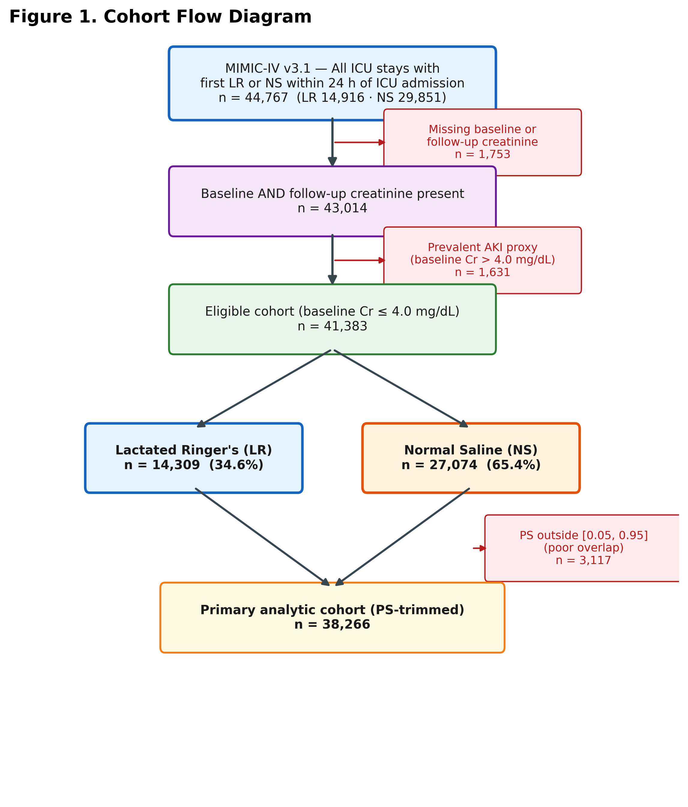{ width=85% }

**Figure 1B.** IDEALIST cohort flow diagram.

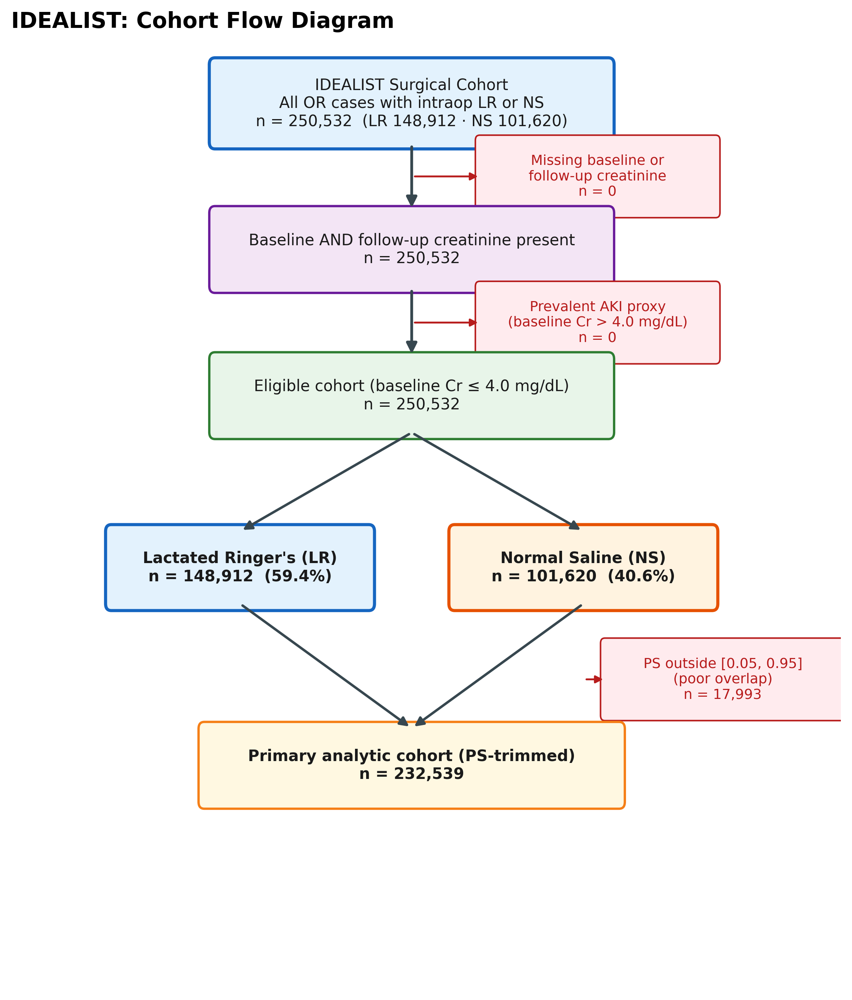{ width=85% }

**Figure 2.** Covariate balance love plots before and after IPTW. Left: MIMIC-IV. Right: IDEALIST. All |SMD| <0.1 after weighting in both cohorts.

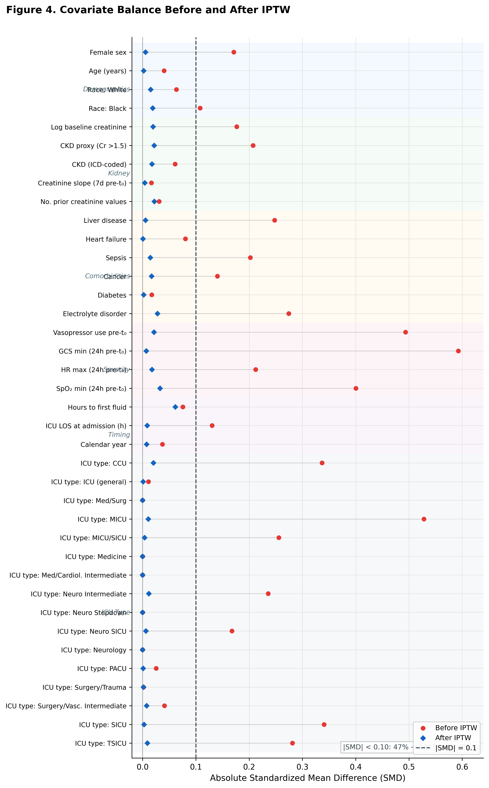{ width=48% }
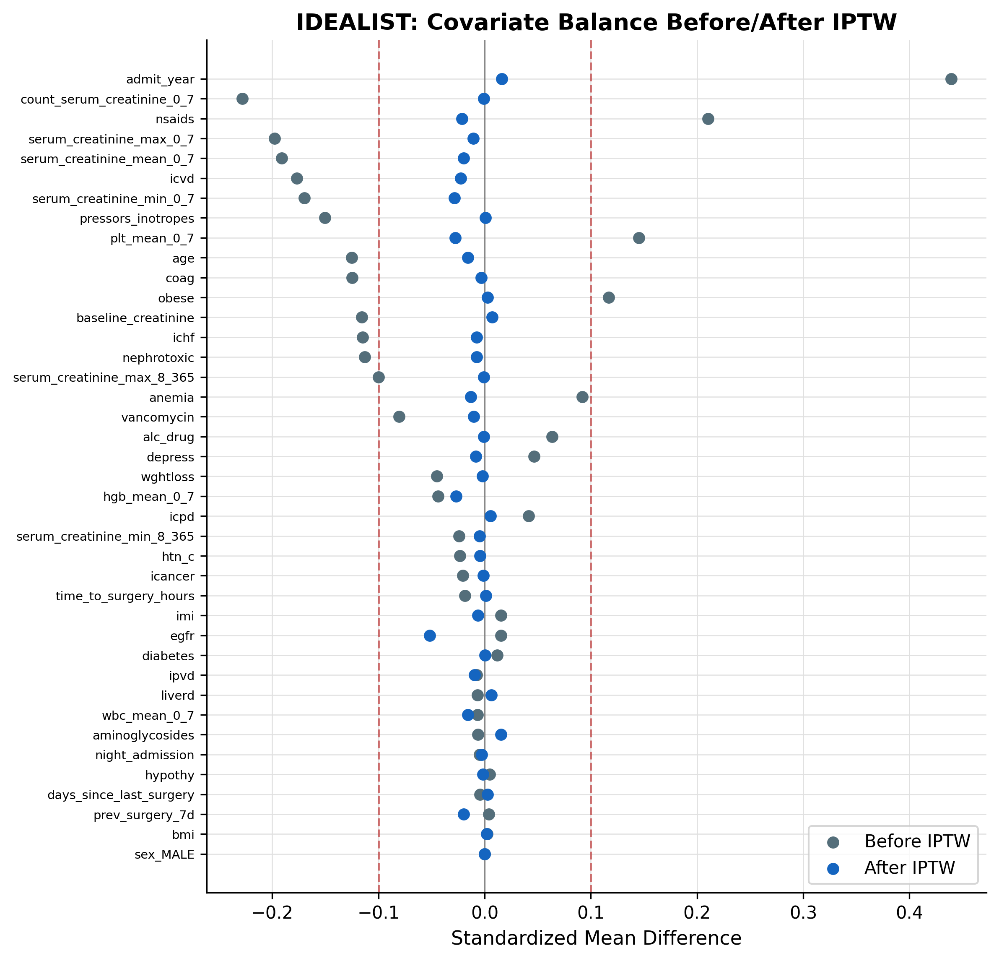{ width=48% }

**Figure 3.** Propensity score overlap. Left: MIMIC-IV. Right: IDEALIST.

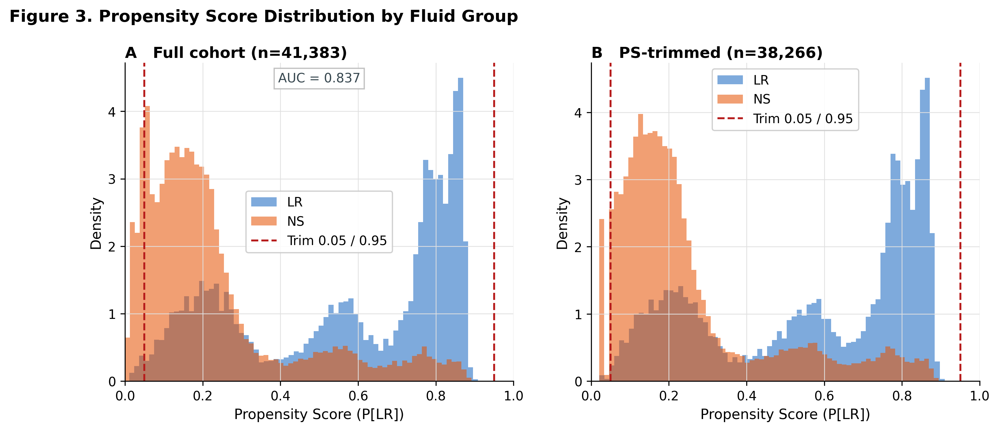{ width=48% }
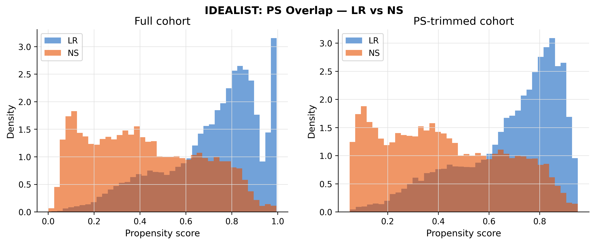{ width=48% }

**Figure 4.** Primary AIPW estimates: head-to-head comparison of MIMIC-IV (critical care) vs IDEALIST (perioperative surgery). Points = adjusted risk differences; bars = 95% bootstrap CIs.

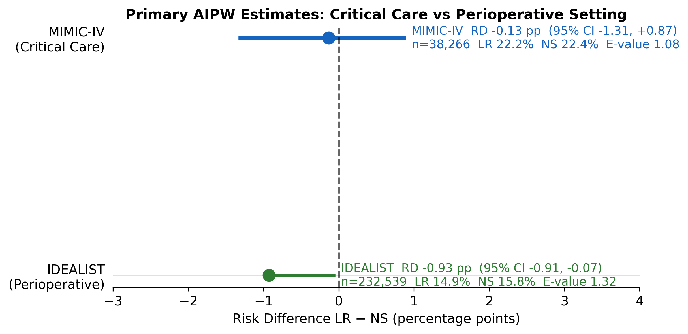{ width=90% }

**Figure 5.** Cross-cohort forest plot: LR vs NS adjusted risk differences across shared sensitivity analyses. Left panel: MIMIC-IV. Right panel: IDEALIST. Red = statistically significant.

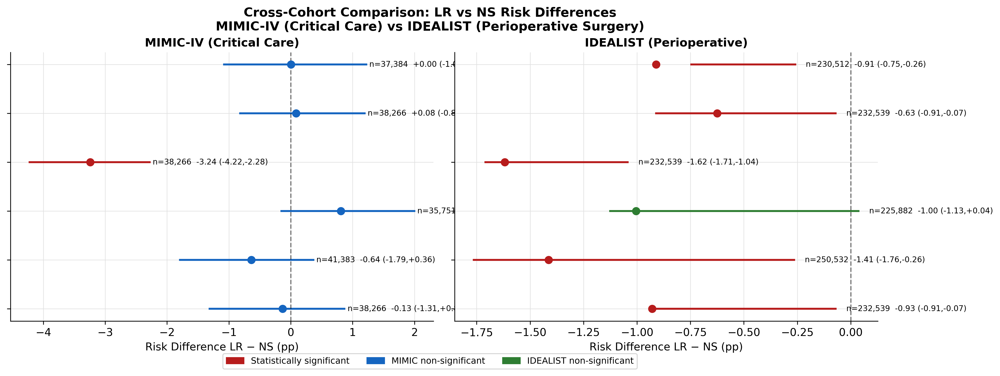{ width=100% }

**Figure 6.** Subgroup forest plots. Left: MIMIC-IV by ICU type. Right: IDEALIST by surgery type.

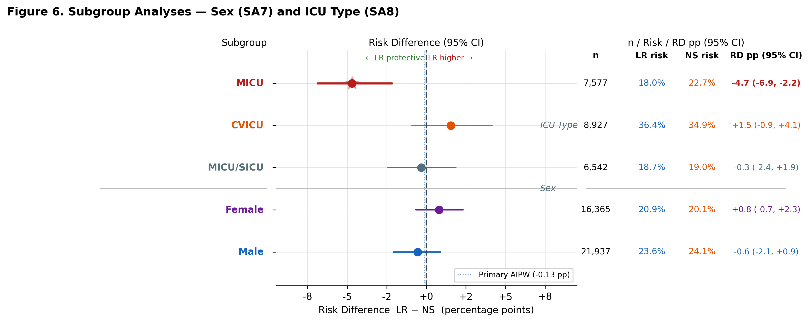{ width=48% }
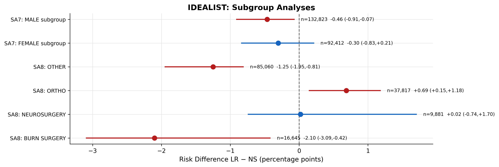{ width=48% }

**Figure 7.** Competing-risks cumulative incidence functions. Left: MIMIC-IV. Right: IDEALIST.

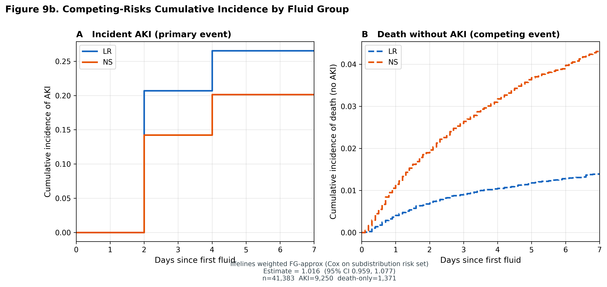{ width=48% }
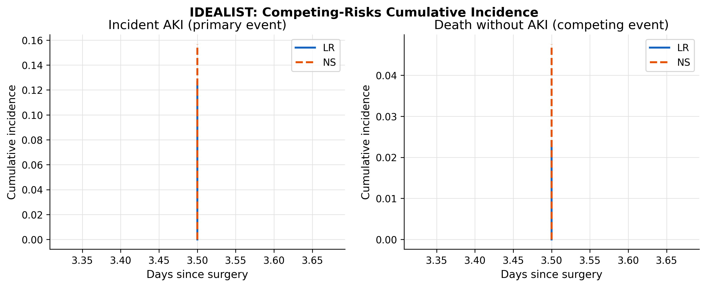{ width=48% }

**Table 1.** Unified cross-cohort comparison of key characteristics and primary results.

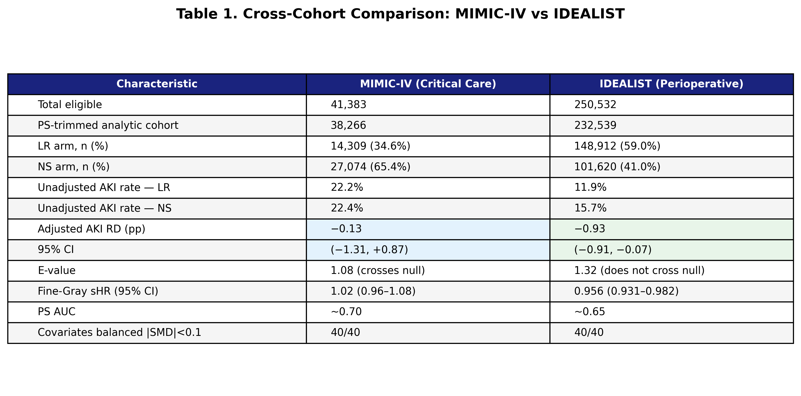{ width=95% }
